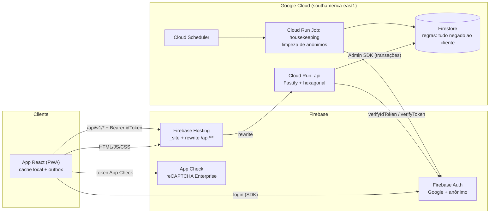
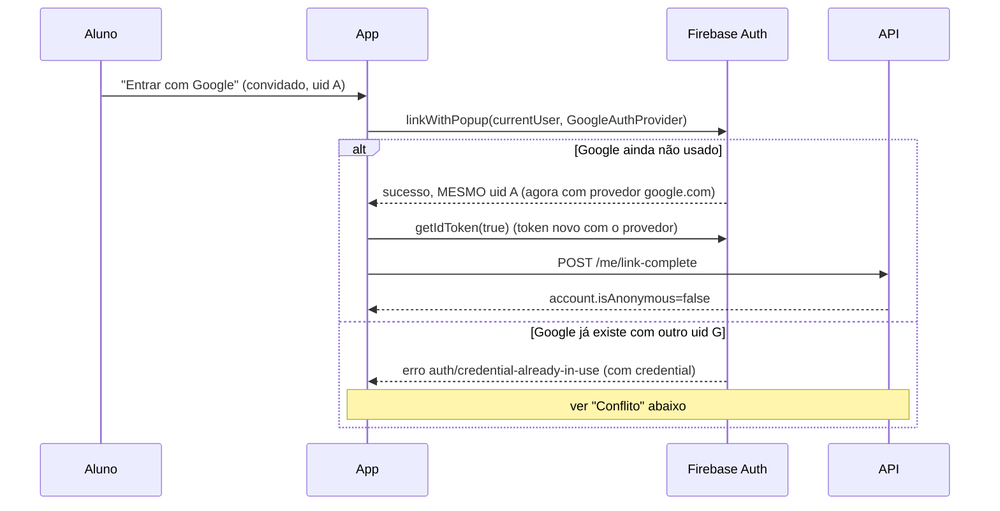

# Back-end do Pingo Quest: plano de arquitetura

Status: plano (nenhum código de produção escrito). Substitui `docs/supabase-presentes.md` (o Supabase saiu do plano) e a seção "Depois" de `docs/hospedagem.md`.

Estado atual (2026-11-25): projeto Google Cloud `pingoquest` (conta de faturamento do amigo, dona e amigo como Owner). Firebase adicionado, 8 APIs ativadas, Firestore `(default)` criado em `southamerica-east1` (modo nativo). Falta: alerta de orçamento, ativar os logins Google e Anônimo, configurar a Google Auth Platform e registrar o app Web (ver seções 6 e 8 e o passo 0 da seção 11). Um projeto Firebase duplicado criado por engano (`pingoquest-cd780`) foi apagado.

Convenções deste documento: `pingoquest` é o placeholder do ID do projeto (o nome de exibição é "PingoQuest"; o ID, que costuma ter um sufixo, aparece em Console > Configurações do projeto). "Chips" é o nome na interface e na API; no código atual do app é `S.gems` (o doc antigo chama de cristais). "Energia" é `S.xp`.

## 1. Visão geral

Hoje o app React (`app/`) é 100% cliente: todo o progresso, a carteira e as regras de recompensa vivem no `localStorage` (`pingoquest-v3`), e a data dos eventos é a do relógio do aparelho. Isso impede três coisas que a dona quer: salvar por conta, impedir manipulação de data e de saldo, e ter amigos e presentes reais.

Decisões já tomadas (resumo):

| Tema | Decisão |
|---|---|
| Hospedagem do app | Firebase Hosting (já existe `firebase.json` servindo `_site`) |
| Identidade | Firebase Auth: Google + convidado anônimo, sem e-mail/senha (seção 6) |
| Dados | Firestore (Native mode), escrito só pela API (Admin SDK) |
| API | Cloud Run, Node + Fastify + TypeScript, hexagonal, Zod nos boundaries |
| Chamada da API | Rewrite do Hosting `/api/**` para o Cloud Run (mesma origem, sem CORS) |
| Autenticação na API | Firebase ID token em `Authorization: Bearer`, verificado na API |
| Cloudflare | Depois, só DNS, fora do escopo |
| Projeto GCP | Um projeto de um amigo que divide a conta com ela |

### Diagrama



O cliente nunca fala com o Firestore. Há um único caminho de escrita e de leitura (a API), então a autorização mora em um lugar só.

### Exceção de leitura direta: nenhuma

Considerei liberar leitura de `users/{uid}/...` para o dono (economiza chamadas e permite listener em tempo real da caixa de presentes). Não vale agora: obriga a manter regras de leitura, App Check no Firestore e modelo de dados pensado para o cliente. A caixa de presentes funciona bem com busca ao abrir a tela e ao voltar o foco da aba. Reavaliar só se o custo de leituras ou a latência virarem problema.

## 2. Estrutura de pastas do serviço

`api/` na raiz do repo, hexagonal, com contextos (bounded contexts) independentes, o mesmo espírito de `features/` do padrão do time. Gerenciador de pacotes: npm (o `app/` usa `package-lock.json`).

```
api/
├── Dockerfile
├── package.json / package-lock.json / tsconfig.json
├── vitest.config.ts               # projetos: unit e integration
├── firebase.json                  # só emuladores (auth, firestore)
├── firestore.rules                # allow read, write: if false
├── firestore.indexes.json
├── contracts/                     # Zod schemas + types das rotas (fonte única)
│   ├── common.ts                  # erro, serverDay, saldo
│   ├── identity.ts  progress.ts  rewards.ts  events.ts  wallet.ts  social.ts  admin.ts
├── src/
│   ├── main.ts                    # entrypoint: lê env, monta o container, sobe o Fastify
│   ├── composition/               # ÚNICO lugar que conhece mais de um contexto (wiring e adapters de integração)
│   │   ├── container.ts
│   │   └── economy-for-social.ts  # adapta o contexto economy ao port que social precisa
│   ├── config/env.ts              # Zod das variáveis de ambiente
│   ├── shared/
│   │   ├── domain/                # Result, DomainError, ServerDay (VO), Clock (port)
│   │   ├── infrastructure/        # firestore-client, unit-of-work (transação), logger, system-clock
│   │   └── presentation/          # auth hook (idToken), app check hook, error handler, rate limit
│   ├── contexts/
│   │   ├── identity/              # conta, bootstrap, import do localStorage, link/merge/adopt, exclusão (LGPD)
│   │   ├── progress/              # sync do estado do cliente (know, miss, av...), regras de merge
│   │   ├── economy/               # ledger, carteira, regras de recompensa, missões, baú, gasto
│   │   ├── events/                # janela, etapas, peças, prêmio
│   │   ├── social/                # perfil público, amigos, presentes
│   │   └── admin/                 # ferramentas de dono (B5)
│   │   (cada um com:)
│   │   ├── domain/                # entities, VOs, regras puras, ports (interfaces de repositório)
│   │   ├── application/           # use cases, DTOs
│   │   ├── infrastructure/        # repositórios Firestore, catálogo de conteúdo
│   │   └── presentation/          # rotas Fastify + schemas Zod (importados de contracts/)
│   └── jobs/
│       └── housekeeping.ts        # Cloud Run Job: limpeza de anônimos e intents vencidas
├── content/ (NÃO existe aqui)     # o Dockerfile copia ../content/*.json para a imagem
└── test/
    ├── unit/                      # domínio e use cases com fakes
    ├── integration/               # Fastify inject + Firebase Emulator
    └── rules/                     # teste das security rules
```

Regras de dependência (as mesmas do projeto, aplicadas à API):

| Regra | Como se aplica |
|---|---|
| Domain não depende de infraestrutura | `domain/` só importa de `shared/domain`. Repositórios são interfaces no domain, implementação em `infrastructure/` |
| Contextos não importam uns dos outros | Quando um precisa do outro (presentes debitam a carteira), o use case declara um port em `application/ports` e o adapter vive em `src/composition/` |
| Use cases orquestram, rotas não | A rota só faz: validar com Zod, chamar o use case, mapear erro para HTTP |
| Transação atravessa repositórios | `UnitOfWork.run(tx => ...)` em `shared/infrastructure`; cada repositório recebe o `tx`. O domain enxerga só a interface `UnitOfWork` |
| Value objects imutáveis e auto-validantes | `ServerDay`, `Nick`, `InviteCode`, `ChipAmount`, `LedgerKey`, `GiftAmount` |
| Entities com id | `Account(uid)`, `Gift(id)`, `LedgerEntry(id)`, `EventProgress(uid, eventId)` |

Pasta `contracts/`: segue o precedente do alias `@content` no Vite. O app importa só tipos (`import type`, custo zero no bundle) por um alias `@contracts`; a API usa os schemas Zod. Uma fonte de verdade, sem pacote de workspace.

Conteúdo: o `Dockerfile` roda com contexto na raiz do repo (`docker build -f api/Dockerfile .`) e copia `content/*.json` para a imagem. A API carrega o catálogo no boot (fases válidas, regras de evento, chamados). A tabela de recompensas passa a ficar só no servidor (`economy/domain`); o cliente mostra o que o servidor devolveu em vez de recalcular.

## 3. Contrato da API por fase

Convenções gerais:

| Item | Regra |
|---|---|
| Base | `/api/v1`, JSON, UTF-8 |
| Auth | `Authorization: Bearer <Firebase ID token>`; `X-Firebase-AppCheck: <token>` (modo `log` no B1, `enforce` quando estável) |
| Cache | Toda resposta com `Cache-Control: private, no-store` (o CDN do Hosting não pode guardar dado de usuário) |
| Idempotência | Rotas que pagam ou gastam recebem `attemptId` (UUID gerado no cliente ao iniciar a atividade). Repetir o mesmo `attemptId` devolve a resposta original, sem pagar de novo |
| Data oficial | Toda resposta que depende de dia traz `serverDay` (`AAAA-MM-DD`, fuso `America/Sao_Paulo`) |
| Erro | `{ "error": { "code": "snake_case", "message": "pt-BR", "details"?: {} } }` |
| Limite | 60 req/min por uid (global); rotas de escrita mais estritas. Excedeu: `429 rate_limited` |
| Tamanho | Corpo máximo 256 KB |

Códigos HTTP e erros comuns:

| HTTP | `code` | Quando |
|---|---|---|
| 400 | `invalid_input` | Falhou no Zod |
| 401 | `unauthenticated` / `invalid_token` | Sem token, expirado ou inválido |
| 401 | `app_check_failed` | App Check ausente/ inválido com modo `enforce` |
| 403 | `account_required` | Rota social chamada por convidado (anônimo) |
| 403 | `forbidden` | Sem permissão (admin) |
| 404 | `not_found` | Recurso inexistente |
| 409 | `conflict` | Disputa de estado (já resgatado, apelido em uso etc.; ver o `code` específico) |
| 422 | `rule_violation` | Regra de negócio (ver `code` específico por rota) |
| 429 | `rate_limited` | Limite de uso |

### B0: fundação (sem funcionalidade para o aluno)

| Método e rota | Auth | Entrada | Saída | Erros |
|---|---|---|---|---|
| `GET /api/v1/health` | não | | `{ ok: true, version }` | |
| `GET /api/v1/time` | não | | `{ now, serverDay, tz }` | |

Serve para validar o rewrite do Hosting, a região, o deploy por WIF e as variáveis de ambiente.

### B1: login e progresso na conta

| Método e rota | Entrada | Saída | Erros específicos |
|---|---|---|---|
| `POST /me/bootstrap` (idempotente) | nada | `{ account:{uid,isAnonymous}, rev, importPending:boolean, serverDay }`. Cria `users/{uid}`, `data/progress` e `data/game` vazios se não existirem (apelido e código públicos só no B4) | |
| `GET /me/state` | | `{ rev, state:{progress,game}, serverDay }` (schema `getStateResponseSchema` em `api/contracts/progress.ts`) | |
| `PATCH /me/state` | `{ baseRev, changes:{progress?,game?} }`: valores absolutos só dos campos tocados; campo ausente = não tocou; `miss[q]: 0` remove a pergunta. Schema `patchStateRequestSchema` | `{ rev, state:{progress,game} }` sempre o estado completo já mesclado | `422 invalid_input` (campo desconhecido, `changes` vazio, limite de chaves), `413` |
| `POST /me/import` (uma vez por conta) | `{ legacy: <objeto pingoquest-v3> }` | `{ rev, state, report:{accepted[],clamped[],dropped[]} }` | `409 already_imported`, `422 invalid_legacy_save` (raiz que não é objeto, ou mapa com chaves acima do limite) |
| `POST /me/link-complete` | nada (lê o token: provedor agora é `google.com`) | `{ account }` marca `isAnonymous=false`. Se `users/{uid}` não existir, faz o mesmo que o `bootstrap` (cria os documentos) já como não anônimo | `409 not_linked` (token ainda sem provedor Google) |
| `GET /me/summary` | | `{ phasesDone, chips, energy, items, lastSeenAt }` (resumo para a tela de conflito) | |
| `POST /me/merge-intent` | nada (chamado como convidado, antes do login Google) | `{ intentId, expiresAt }` (10 min, uso único) | |
| `POST /me/adopt` | `{ intentId }` (chamado já como conta Google) | `{ account }`; copia o progresso do convidado por cima da conta e apaga o convidado | `404 intent_not_found`, `409 intent_used`, `422 intent_expired`, `403 account_required` |
| `GET /me/export` | | JSON com todos os dados do aluno (portabilidade LGPD) | |
| `DELETE /me` | `{ confirm: true }` | `204`; apaga dados e o usuário no Auth | |

### B2: data oficial e recompensas registradas (ledger)

Importante: o servidor passa a calcular o valor pago. O cliente só informa fatos da atividade (acertos, erros, sequência) e o `attemptId`.

| Método e rota | Entrada | Saída | Erros específicos |
|---|---|---|---|
| `GET /events` | | `{ serverDay, events:[{ id, phase:'soon'|'open'|'ended', window, steps, progress, canStart }] }` (só os visíveis, regra de `evVisible`) | |
| `POST /events/:eventId/steps/:stepId/complete` | `{ attemptId, correct, total, elapsedMs }` | `{ pass, xp, got:{pieces,chips}\|null, full, progress, balanceDelta, serverDay }` | `422 event_closed`, `422 step_done_today` (1 etapa por dia), `422 step_locked` (chamado não destravado), `422 implausible_attempt`, `404 unknown_step` |
| `POST /rewards/phase` | `{ attemptId, courseId, phaseKey:'gi-fi', kind:'lesson'\|'boss'\|'review'\|'practice', correct, wrong, bestRun, pairs, elapsedMs }` | `{ xp, chips, firstTime, perfect, newItems[], newAchievements[], balanceDelta }` | `404 unknown_phase`, `422 phase_locked`, `422 implausible_attempt` |
| `POST /rewards/case` | `{ attemptId, courseId, caseKey, kind:'daily'\|'node', wrong, inspected }` | `{ stars, xp, chips, balanceDelta }` | `404 unknown_case`, `422 already_paid` |
| `GET /missions/today` | | `{ serverDay, missions:[{ index, text, goal, progress, reward, claimed }], chest:{ ready, opened, reward } }` | |
| `POST /missions/:index/claim` | `{ attemptId }` | `{ chips, balanceDelta }` | `422 goal_not_reached`, `409 already_claimed` |
| `POST /chest/open` | `{ attemptId }` | `{ chips, balanceDelta }` | `422 chest_not_ready`, `409 already_claimed` |

`balanceDelta` existe porque no B2 o saldo ainda mora no cliente (o cliente aplica o delta devolvido); no B3 ele passa a ser só informativo. Quem alimenta missões, sequência, `hist`, `wk` e conquistas é o servidor, como efeito colateral dessas rotas (hoje `touchStreak`, `wkAdd`, `cqSync`).

### B3: carteira oficial

| Método e rota | Entrada | Saída | Erros específicos |
|---|---|---|---|
| `GET /wallet` | | `{ energy, chips, serverDay }` | |
| `POST /wallet/spend` | `{ attemptId, sku:'heart_refill', qty? }` (preço na tabela do servidor) | `{ energy, chips, applied }` | `422 insufficient_chips`, `404 unknown_sku` |

A partir daqui `GET /me/state` não traz mais `gems`/`xp`, e `PATCH /me/state` rejeita esses campos. Fim do import: o endpoint `POST /me/import` é removido uma janela depois do B3 (sem camada de compatibilidade; ver seção 5).

### B4: amigos e presentes

Rotas abaixo exigem conta Google (`403 account_required` para convidado).

| Método e rota | Entrada | Saída | Erros específicos |
|---|---|---|---|
| `PUT /me/profile` | `{ nick }` (2 a 14 caracteres) | `{ nick }` | `409 nick_taken`, `422 nick_invalid` |
| `GET /me/invite` | | `{ code, link }` | |
| `POST /me/invite/rotate` | | `{ code }` | |
| `POST /friends` | `{ code }` | `{ friend:{ uid, nick } }` | `404 code_not_found`, `422 cannot_add_self`, `409 already_friends`, `422 friend_limit` |
| `GET /friends` | | `{ ranking:[{ uid, nick, avatar, weeklyXp, streak, me }] }` | |
| `DELETE /friends/:uid` | | `204` | |
| `POST /gifts` | `{ attemptId, toUid, type:'energy'\|'chips'\|'item', amount?, itemId?, msgId:0..2 }` | `{ giftId, balance }` | `422 not_friends`, `422 daily_limit` (3 por dia por amigo), `422 bad_amount`, `422 insufficient_balance`, `422 item_not_giftable`, `422 account_too_new` |
| `GET /gifts/inbox` | | `{ gifts:[{ id, fromNick, type, amount, itemId, msgId, createdAt }] }` (status `sent`) | |
| `GET /gifts/sent?limit=` | | lista dos enviados | |
| `POST /gifts/:id/claim` | | `{ gift, extraChips, balance }` (20 chips se já tinha o item) | `404 gift_not_found`, `409 already_claimed` |

Regras herdadas do desenho antigo (agora em Firestore): quantidades fixas (energia 10/25/50, chips 10/20/50), só itens de evento são dáveis, quem dá perde na hora, quem recebe só ganha no `claim`, mensagem só entre as 3 pré-definidas (`msgId`, não texto livre; reduz risco de moderação e LGPD).

### B5: modo dono vira ferramenta de admin

Rotas exigem custom claim `admin: true` no ID token e `checkRevoked`. Toda chamada grava em `adminAudit`.

| Método e rota | Entrada | Saída | Erros |
|---|---|---|---|
| `GET /admin/users/:uid` | | estado completo + carteira + ledger recente | `403 forbidden`, `404` |
| `POST /admin/users/:uid/day-offset` | `{ days }` (0 a 30; só para contas marcadas `isTester`) | `{ serverDayForUser }` | `422 not_a_tester` |
| `POST /admin/users/:uid/events/:eventId/reset` | | `{ ok }` (zera etapas e apaga as entradas de ledger do evento desse usuário) | `422 not_a_tester` |

Mudanças em relação ao "Modo dono" de hoje: "Avançar 1 dia" deixa de mexer no relógio e vira um deslocamento de dia só para contas de teste (o dia dos demais alunos nunca muda); "Reiniciar o evento" só funciona em conta de teste. A claim é concedida por script do dono com o Admin SDK (`api/scripts/grant-admin`), sem tela. Uma tela de admin no app é opcional e só depois.

## 4. Modelo do Firestore

Banco: Firestore Native, localização `southamerica-east1` (a localização é permanente; checar se já existe um banco `(default)` no projeto antes de criar). Campos em `camelCase` (convenção do Firestore/JS; o `snake_case` da regra de banco vale para SQL). Ativar proteção contra exclusão do banco e backup agendado.

### Modelo do B1 (identity + progress), fechado sobre o save real

Base: `app/src/lib/*.ts` e `content/*.json` (o desenho anterior foi feito antes de ler o código). Schemas e limites em `api/contracts/progress.ts` (fonte única); o que está abaixo é o mapa.

O B1 é só persistência por conta e sincronização entre aparelhos. Não há integridade de economia: o cliente continua pagando recompensa localmente (`patchSave`) e o servidor apenas guarda e mescla. Anti-fraude (recompensa, data, saldo) começa no B2/B3.

| Documento | Campos (tipos) | Dono e escrita |
|---|---|---|
| `users/{uid}` | `isAnonymous` bool, `createdAt` timestamp, `lastSeenAt` timestamp, `importedAt?` timestamp, `schema` 1 | API. `lastSeenAt` é atualizado no `bootstrap` e no `PATCH`/import só se o valor guardado tiver mais de 1 h (evita escrita extra). Sem apelido, código, e-mail ou foto |
| `users/{uid}/data/progress` | `rev` int, `schema` 1, `updatedAt`, `curso` string (curso ativo), `plan` 0\|3\|5\|7, `hearts` 0..99, `nick` string até 14 (provisório, sem unicidade; vira `users.nick` no B4), `av` map slot para id, `total` e `ok` int, `onb` bool, `onbC` map curso para true, `picked` bool, `level` ''\|'zero'\|'alguma', `duel` {w,l,d}, `miss` map texto da pergunta para contagem (global, não por curso), `courses` map curso para `{know: map conceito para {ok,bad,seen 0\|1,at?}, xch: map grupo para {w,t}, xseen: texto[] até 60}` | Cliente, permanente (o servidor só mescla) |
| `users/{uid}/data/game` | `schema` 1, `updatedAt`, `gems`, `xp`, `streak`, `best`, `last` (data ou ''), `perfectN`, `lupa`, `hist` set de datas, `wk` {k,xp}\|null, `week` {k,n,claimed,days[0..6]}\|null, `day` (12 campos, ver contrato)\|null, `conq` set, `badges` data[], `inv` {items[], coll set}, `ev` map evento para {steps map etapa para {day,c}, used[] até 80, pieces, fresh, status?}, `ledger` set de chaves (`ev:<evento>:<etapa>`, `ev:<evento>:prize`), `courses` map curso para `{done: set "g-f", bosses, casos: map id para {n,best 0..3}}` | Cliente, provisório (mescla por máximo/união). Do servidor a partir do B2/B3 |

Conjuntos (`set`) são `map<string,true>`. A chave `gems ?? 50` do cliente vira o valor inicial de `game.gems` (50) criado pelo `bootstrap`; o `ledger/starter` real nasce no B2.

Diferenças em relação ao plano anterior:

| Mudança | Por quê |
|---|---|
| `miss` sai de dentro do curso e fica global em `progress` | No cliente `miss` não está em `COURSE_KEYS`: é um mapa único cujas chaves (texto da pergunta) vêm dos dois cursos |
| `know` é por conceito (`rede.def`, 64 conceitos nos dois cursos), com `seen` 0\|1 e `at` | É o formato real (`S.know[cid]`); o plano falava de `seen` como OU, o que continua valendo |
| `done` é `map "g-f" -> true`, não data | É o que o app grava; a data da conclusão não existe no save |
| `xseen` é lista de textos de pergunta (máx. 60 por curso), `xch` é por grupo `{w,t}` | Formato real do "Desafio do Pingo" |
| `game` existe já no B1 e guarda `gems`, `xp`, `ledger`, `ev`, `inv`, `day` etc. | Sem isso o "salvar progresso" não salvaria fase concluída nem saldo, que hoje só vivem no cliente |
| Sem `users/{uid}/ledger` e sem `data/wallet` no B1 | O `ledger` do save é um mapa de chaves de dedupe (cabe em `game.ledger`); o ledger de lançamentos e a carteira nascem no B2/B3 com uma migração única de `game.gems/xp` para o lançamento `import` |
| `onb`, `onbC`, `picked`, `level`, `duel`, `nick`, `av`, `hearts`, `plan`, `total`, `ok` entram em `progress` | Estão no save e afetam a experiência em outro aparelho (por exemplo, repetir o onboarding, que paga 20 chips) |
| `account` do `bootstrap` é `{uid,isAnonymous}` | Apelido e código públicos só existem a partir do B4 |
| Descartados no import: `fr`, `gifts`, `code`, `maxDay`, `devStart` | De mentira ou do relógio do aparelho |

Campo `rev`: inteiro em `data/progress`, começa em 1 no `bootstrap`. Toda escrita que muda o estado (PATCH, import, `adopt`, e no B2 as rotas de recompensa, com `FieldValue.increment(1)` sem leitura) avança `rev` em +1 na mesma transação.

Fica para o B2/B3: ledger de lançamentos, carteira, `events/{eventId}` (sai de `game.ev`; fazer antes de passar de 10 eventos por aluno), `week`/`streak`/`avatar` espelhados em `users` e `nick`/`code`/`nickLower` (B4), `mergeIntents` (B1c), `giftQuota`, `gifts`, `friends`, `adminAudit`.

#### Tamanho no pior caso (limite do documento: 1 MiB)

Calculado com as regras de tamanho do Firestore (nome do campo + valor + 32 bytes do documento), com o catálogo real: 458 perguntas únicas (237 redes, 221 linux, inclui bate-bola), maior pergunta com 115 bytes, 64 conceitos, 25 paradas, 20 casos, 2 eventos.

| Documento | Pior caso real | Observação |
|---|---|---|
| `data/progress` | cerca de 36,5 KB | `miss` com as 458 perguntas ocupa cerca de 25 KB; `know` e `xseen` somam o resto |
| `data/game` | cerca de 18,5 KB | `ev` (2 eventos com 80 `used` cheios) 9 KB; `hist` 400 dias 4,8 KB; `badges` 3 anos 1,7 KB |
| Limite adversarial do contrato | cerca de 740 KB | `miss` 600 chaves de 160 caracteres a 3 bytes/char: 293 KB; `ev` 10 eventos x 80 `used`: 385 KB; `xseen`: 58 KB. Fica abaixo de 1 MiB. Na prática o servidor também descarta chaves que não estão no catálogo, então o limite real é o catálogo |

`LIMITS.miss` (600) deve subir junto com o catálogo (hoje 458). O `hist` é cortado pelo servidor nos últimos 400 dias ao gravar. O corpo do PATCH continua limitado a 256 KB. Escrever sempre o documento inteiro (`set` dentro da transação), nunca `update` com caminho de campo dinâmico: as chaves de `miss` são texto de pergunta e podem ter ponto, barra e aspas. O contrato rejeita chaves vazias ou no formato reservado `__x__`.

#### Índices e TTL (B1)

| Item | Decisão |
|---|---|
| Composto | `users(isAnonymous ASC, lastSeenAt ASC)`: a limpeza diária de convidados inativos consulta `isAnonymous == true` e `lastSeenAt < corte`. É o único índice composto do B1 |
| Exceções de indexação | Grupo de coleções `data`: `miss`, `courses`, `ev`, `hist`, `ledger` sem índice. Esses documentos só são lidos por caminho; as chaves são dado do aluno (texto de pergunta) e não devem ocupar o limite de entradas de índice por documento nem aumentar custo de escrita. A subcoleção `data` é a mesma que receberá `wallet` no B3 |
| Limpeza de "convidado vazio" | O job lê `data/game` dos candidatos (inativos entre 7 e 90 dias) e confere se há alguma fase em `courses.*.done`. São poucas leituras por dia; não vale guardar um contador em `users` agora |
| TTL | Nenhum no B1. `mergeIntents.expiresAt` (B1c) e `giftQuota.expiresAt` (B4) usam política de TTL do Firestore, criada por `gcloud firestore fields ttls update expiresAt --collection-group=<nome>` (documentar no PR do B1c) |
| Validação | O emulador não valida `firestore.indexes.json`; a primeira validação real é o `firebase deploy --only firestore:indexes` pelo `devops`. Se a exceção de campo de mapa for recusada, remover só os `fieldOverrides` (os índices simples automáticos continuam dentro do limite) |

### Coleções

Visão completa (B1 acima; o resto vem nas fases seguintes). Para `users/{uid}`, `data/progress` e `data/game`, a tabela do B1 manda.

| Caminho | Quem escreve | Campos principais | Observações |
|---|---|---|---|
| `users/{uid}` | API | B1: ver acima. B4 acrescenta: `nick`, `nickLower`, `code`, `avatar` (slots equipados, espelho público), `week:{k,xp}`, `streak`, `bestStreak`, `lastDay`; B5: `testDayOffset?`, `isTester?` | O que amigos enxergam (apelido, avatar, xp da semana, sequência) vem daqui. Sem e-mail, sem foto (o e-mail fica só no Auth) |
| `users/{uid}/data/progress` | API (via `PATCH /me/state`, import, `adopt`) | Ver tabela do B1 | Estado do aluno que continua do cliente (seção 5) |
| `users/{uid}/data/game` | API | Ver tabela do B1 | Autoridade do servidor a partir do B2 (no B1 recebe merge do cliente) |
| `users/{uid}/data/wallet` | API | `chips`, `energy`, `updatedAt` | Invariante: saldo = soma do ledger. Atualizado na mesma transação da entrada do ledger |
| `users/{uid}/ledger/{entryId}` | API (só `create`) | `kind` (`reward`/`spend`/`gift_out`/`gift_in`/`import`/`starter`/`admin`), `source`, `ref`, `delta:{chips,energy}`, `balanceAfter`, `serverDay`, `at`, `attemptId`, `result` (resposta original, para repetir idempotente) | `entryId` é a chave de dedupe: `ev:rede-conectada:s1`, `ev:rede-conectada:prize`, `phase:redes:0-1:first`, `starter`, ou `attempt:<uuid>` para o repetível. `create` falha se já existe, e isso é a trava contra pagamento duplicado. Mantém o formato de chave do `S.ledger` atual |
| `users/{uid}/events/{eventId}` | API | `steps:{s1:{day,correct,at}}`, `pieces`, `status`, `prizeAt`, `used[]` | Substitui `S.ev` |
| `users/{uid}/friends/{friendUid}` | API | `since` | Gravada nos dois lados na mesma transação (amizade mútua) |
| `users/{uid}/giftQuota/{friendUid_AAAAMMDD}` | API | `count`, `expiresAt` | Limite de 3 presentes por dia por amigo. TTL em `expiresAt` |
| `gifts/{giftId}` | API | `fromUid`, `toUid`, `type`, `amount`, `itemId`, `msgId`, `status:'sent'\|'claimed'`, `createdAt`, `claimedAt`, `extraChips` | Índices: `(toUid, status, createdAt desc)` e `(fromUid, createdAt desc)` |
| `nicks/{nickLower}` | API | `uid` | Garante apelido único via transação (mesma regra do `unique` do desenho antigo) |
| `invites/{code}` | API | `uid` | Código de convite (6 caracteres, alfabeto sem ambíguos como hoje) |
| `mergeIntents/{id}` | API | `fromUid`, `createdAt`, `expiresAt`, `usedAt?` | Prova de que quem chamou `adopt` controlava o convidado. TTL em `expiresAt` |
| `adminAudit/{id}` | API | `adminUid`, `action`, `targetUid`, `params`, `at` | Só para B5 |

Por que `ledger` por usuário em subcoleção e `gifts` no topo: o ledger é sempre lido/escrito junto da carteira do dono; o presente tem dois donos (quem deu e quem recebe) e precisa de consulta pela caixa de entrada.

Por que a carteira é um doc só e não um campo no `users`: isola a contenção de escrita (limite sustentado de cerca de 1 escrita por segundo por documento) e mantém o documento público enxuto.

### Security rules (esboço)

```
rules_version = '2';
service cloud.firestore {
  match /databases/{database}/documents {
    match /{document=**} {
      allow read, write: if false;
    }
  }
}
```

O Admin SDK ignora as regras, então a API continua funcionando. O teste de regras (`@firebase/rules-unit-testing`) garante que nenhum caminho está aberto, nem para usuário autenticado.

### Transações (exemplos de invariantes)

| Operação | Leituras (antes) | Escritas (mesma transação) |
|---|---|---|
| Pagar recompensa | `ledger/{key}` (se existe, devolve `result` guardado), `wallet`, `game` | `create ledger`, `wallet` (increment), `game` (done, conquistas, itens), `users.week/streak` |
| Gastar | `wallet` | `create ledger`, `wallet` (se saldo >= preço) |
| Enviar presente | `wallet` ou `game.inv`, `friends/{to}`, `giftQuota`, conta do remetente (idade) | `wallet`/`inv` (debita), `create ledger`, `create gifts`, `giftQuota` (+1) |
| Receber presente | `gifts/{id}`, `wallet`/`inv` do destino | `gifts` (status), `wallet`/`inv`, `create ledger` |
| Trocar apelido | `nicks/{novo}`, `users/{uid}` | `create nicks/{novo}`, `delete nicks/{antigo}`, `users.nick` |

## 5. Estratégia de sincronização do progresso

### O que é de quem

| Dado (chave do `S` atual) | Dono | A partir de | Regra |
|---|---|---|---|
| `know`, `miss`, `xch`, `xseen` | Cliente, sincronizado | B1 | Merge pelo servidor (tabela abaixo). `miss` é global; `know`, `xch` e `xseen` são por curso. Vão em `data/progress` |
| `curso`/`cursos`, `plan`, `hearts`, `nick` (até B4), `av` equipado, `onb`, `onbC`, `picked`, `level`, `duel` | Cliente, sincronizado | B1 | Última escrita vence (ordem de chegada no servidor). `av` só é validado no formato no B1; a regra "itens do aluno" entra no B2. Vão em `data/progress`; no save legado o curso ativo vem achatado e os demais em `cursos[id]`, e o servidor normaliza para `courses[id]` (o achatado vence a cópia antiga em `cursos[ativo]`) |
| Todo o resto do save (ver as linhas "Servidor" abaixo) | Cliente, provisório | B1 | No B1 ainda é o cliente que paga recompensa; o servidor só guarda e mescla em `data/game`. Os campos saem de `changes` quando o B2/B3 os assumir |
| `total`, `ok` (estatísticas) | Cliente, sincronizado | B1 | Máximo |
| tema, som, preferências visuais | Só cliente, não sobe | sempre | Ficam no aparelho (`pingoquest-theme` etc.) |
| `done`, `bosses`, `casos`, `perfectN` | Servidor | B2 | Só mudam por `/rewards/*` e `/events/*` |
| `ledger`, `ev`, `maxDay`, `day`, `streak`, `last`, `best`, `hist`, `wk`, `conq`, `badges`, `lupa` | Servidor | B2 | Cliente só lê. `maxDay` morre (o servidor é o relógio) |
| `inv` (itens, coleção) | Servidor | B2 | Itens de progresso e de evento concedidos pelo servidor |
| `gems` e `xp` (chips e energia) | Servidor | B3 (valor registrado no ledger desde o B2) | Cliente só lê |
| `fr`, `gifts`, `code` | Descartados | B1 | São de mentira (`demoFriends`, `mockIncoming`); não são importados. Em B4 viram dados reais |

`hearts` fica no cliente de propósito: é um recurso de interface, não uma moeda; o que vale (chips) é gasto no servidor. Quem editar o `hearts` local só ganha vidas, não chips. Risco aceito e registrado na seção 10.

### Merge no B1 (convergente, sem depender de relógio)

Roda no servidor (`progress/domain/merge.ts`, função pura, testável por propriedade: comutativa, associativa e idempotente).

| Campo | Regra |
|---|---|
| `done`, `conq`, `hist`, `inv.items`, `inv.coll`, `ledger`, `xch`, `xseen` | União |
| `bosses`, `best`, `total`, `ok`, `gems`, `xp` | Máximo (provisório até B2/B3, quando saem do cliente) |
| `know[c]` | `seen` = OU; `ok` e `bad` = máximo |
| `casos[id]` | `n` e `best` = máximo |
| `streak`/`last` | Fica o par de maior `last`; `best` = máximo |
| `day` | Se mesmo `d`: máximo por contador e OU em `claimed`; senão o mais novo |
| `ev[id].steps` | União; `pieces` recalculado a partir das etapas |
| `miss[q]` | Última escrita vence por chave tocada (o contador pode diminuir ao corrigir, então máximo estaria errado); chave ausente = não tocou, valor 0 remove |
| `ev[id].used` | União, últimos 80 |
| resto (`plan`, `curso`, `av`, `nick`, `hearts`) | Última escrita vence |

#### Decisões de contrato do B1 (PATCH e import)

Fechadas com o `qa-engineer` (pontos [DEFINIR] do `docs/b1-test-plan.md`). Regra geral: a opção mais simples que mantém a convergência.

| # | Ponto | Decisão |
|---|---|---|
| 1 | `baseRev` desatualizado no PATCH | Não rejeita (sem 409). O servidor aplica o merge convergente sobre o estado atual e devolve o estado completo e o `rev` novo; o cliente reconcilia pela resposta. `baseRev` serve só para log e diagnóstico |
| 2 | `miss` ausente no corpo | PATCH parcial: campo ou chave ausente = não tocou. Remoção explícita por valor `0` (`miss[q]: 0`); o estado guardado nunca contém 0. `null` não é aceito. Vale igual para qualquer mapa de `changes` |
| 3 | `ev[id].used` no merge | União dos textos (existentes primeiro, novos depois, sem repetir), mantendo os últimos 80. É só uma heurística de "não repetir logo em seguida", então a ordem exata não precisa ser comutativa |
| 4 | Campo com tipo errado no import | O campo é descartado e listado em `report.dropped`; o import continua. Entradas inválidas dentro de um mapa somem; números fora da faixa são cortados no limite e listados em `report.clamped`. Raiz que não é objeto, ou mapa com mais chaves que o limite, falha com `422 invalid_legacy_save` |
| 5 | `link-complete` sem `users/{uid}` | Cria os documentos como o `bootstrap` (upsert) já com `isAnonymous=false`. Idempotente. `409 not_linked` só se o token ainda não tem o provedor Google |
| 6 | `rev` em PATCH repetido ou `changes` vazio | `rev` só avança se o estado mesclado for diferente do guardado. PATCH repetido ou sem efeito: 200, sem escrita, mesmo `rev`, estado completo. `changes` vazio é rejeitado pelo schema (`422 invalid_input`) |
| 7 | Tamanho máximo de `miss` | 600 chaves de até 160 caracteres por schema (catálogo atual: 458 perguntas). Acima disso: `422 invalid_input` no PATCH e `invalid_legacy_save` no import (o `413` fica só para corpo acima de 256 KB). O servidor descarta chaves que não existem no catálogo |

Também no B1: o `av` do PATCH é validado só no formato (ids de texto curto); a regra "item é do aluno" entra no B2, quando o servidor passa a ser dono de `inv`. No B1 o `inv` é do cliente, então checar `av` contra ele não protegeria nada. O import do B1 não recalcula `inv` nem corta `gems`/`xp` por plausibilidade (passos 3 a 5 da tabela de import ficam para o B2); aplica só os tetos do schema (`gems` e `xp` até 500 mil) e valida `done`/`casos`/`know`/`miss` contra o catálogo.

Limite conhecido do B1: `gems`/`xp` por máximo ignoram gastos feitos em outro aparelho. É aceitável só porque o B1 é curto e porque o B2/B3 remove esses campos do cliente. Por isso o B2 e o B3 devem sair em sequência (ver seção 11).

### Conflito entre aparelhos

Um aluno, em geral, usa um aparelho por vez. Os casos reais:

| Situação | Resultado |
|---|---|
| Joga no celular, abre no PC | O PC faz `GET /me/state`, vê tudo. Sem conflito |
| Joga offline em dois aparelhos e sincroniza depois | B1: merge acima converge. B2+: cada tentativa vira um `attemptId` único, o servidor paga as duas se forem válidas; o que é "uma vez só" (primeira conclusão, etapa do dia, prêmio do evento) só paga uma, pela chave do ledger |
| Duas abas | Mesmo uid, mesmo cache; o `PATCH` é idempotente e mesclado. O cliente escuta o evento `storage` para recarregar |

### Offline

| Ação | Offline | Observação |
|---|---|---|
| Ler progresso, estudar, treinar, revisar | Funciona | Usa o cache local |
| Atualizações de `know`/`miss` | Fila local (outbox) e envio depois | `PATCH` com debounce de 5 s e `fetch` com `keepalive` no `pagehide` |
| Fim de lição (B2+) | Entra na outbox com `attemptId` e é paga ao reconectar | A data/sequência conta no dia do recebimento no servidor. Trade-off aceito: simplicidade, sem relógio do cliente na regra |
| Etapa de evento | Exige internet | A data oficial é do servidor; sem rede, a etapa não conclui e a tela explica |
| Missões, baú, gasto, presentes, amigos | Exigem internet | |

A outbox aceita tentativas com até 24 h; mais velhas são descartadas com aviso (`422 attempt_expired`).

### Cache local e fim do `pingoquest-v3`

| Quando | O que acontece |
|---|---|
| Antes do login | Nada muda: `pingoquest-v3` segue como hoje |
| Primeiro login (B1) | O cliente envia o `pingoquest-v3` em `POST /me/import`. Com a confirmação do servidor, a chave é renomeada para `pingoquest-v3-importado` (não apagada de imediato) |
| Depois | O cache passa a ser `pingoquest-cache-v1` = `{ uid, rev, state, outbox }`, que é só espelho do servidor. Nenhuma tela escreve mais direto no `localStorage` (o `patchSave` atual é substituído por uma camada `lib/api.ts` + store de sessão) |
| Marco de remoção (depois do B3, com data combinada) | Remove `POST /me/import` e o código de leitura do formato antigo; o cliente apaga `pingoquest-v3-importado`. Sem compatibilidade permanente |
| Sair da conta | Apaga `pingoquest-cache-v1` (computadores compartilhados em sala). Convidado não pode "sair" (perderia o acesso para sempre); a interface oferece "Entrar com Google" no lugar |

### Migração do `localStorage` (import)

O servidor nunca confia cegamente no que vem do `localStorage`. `POST /me/import`:

| Passo | Regra |
|---|---|
| 1 | Zod com allowlist (campos desconhecidos são descartados e listados em `report.dropped`); descarta `fr`, `gifts`, `code`, `maxDay` |
| 2 | `done`, `bosses`, `casos` validados contra o catálogo de conteúdo (fases que não existem saem) |
| 3 | Itens de progresso (`inv`) recalculados pelas condições do servidor (fases/provas feitas), não aceitos do cliente. Item de evento só vale se o `ledger` do evento tem o prêmio e as etapas estão dentro da janela, no máximo uma por dia |
| 4 | `gems` e `xp` aceitos com teto plausível calculado do que foi importado (cada fase paga no máximo X, provas Y, missões por dia de `hist`); o excedente é cortado e vai para `report.clamped`. O valor entra no ledger como `kind:'import'` |
| 5 | O bônus inicial de 50 chips (`gems ?? 50` no cliente hoje) passa a ser concedido pelo servidor uma vez (`ledger/starter`) e não é somado de novo à importação |
| 6 | Uma vez por conta (`importedAt`). Convidado novo sem `pingoquest-v3` não importa nada |

Evento em andamento: a Operação Rede Conectada vai de 2026-11-22 a 2026-12-01. O import precisa preservar `S.ev['rede-conectada']` e as chaves `ev:rede-conectada:*` do `S.ledger`. Etapas fora da janela ou duas no mesmo dia são normalizadas na importação (fica a mais antiga do dia). O servidor oficial dos eventos (B2) provavelmente não chega antes de 01/12; esse evento termina na data do aparelho, e o plano não tenta corrigir isso.

Prevenção de repetição do import como fonte de farm: ver risco R5 (seção 10).

## 6. Login: DECIDIDO (Google + convidado, sem e-mail/senha)

Decisão da dona: Google + convidado anônimo. Sem e-mail/senha.

| Opção | Status | Motivo |
|---|---|---|
| Convidado anônimo (`signInAnonymously`) | Adotada | Entra sem fricção; mesmo uid depois de ligar o Google; já habilita sync, data oficial e eventos |
| Google | Adotada | Um clique, sem senha para guardar, sem fluxo de reset |
| E-mail/senha | Descartada | Exige tela de cadastro, verificação, recuperação de senha e suporte; mais superfície de ataque e de LGPD |

Consequência a registrar: alunos sem conta Google (por exemplo, menores de 13 anos sem Family Link) ficam como convidados para sempre, e o convidado perde tudo se limpar os dados do navegador (o uid anônimo vive no IndexedDB). Mitigação: lembrete de "Salvar progresso" logo após a primeira fase e antes de eventos; em B4 o social exige conta Google. Um "código de recuperação" para convidados fica como decisão pendente (R9).

### Configuração do login Google (Google Auth Platform)

A captura do console mostra "A plataforma de autenticação do Google ainda não está configurada". Isso precisa ser feito antes do B1, na ordem abaixo (a pessoa com papel de Owner no projeto, no começo o amigo).

| Passo | Onde | O que fazer |
|---|---|---|
| 1 | Firebase Console | "Adicionar projeto" escolhendo o projeto existente PingoQuest (não criar outro). Exige o plano Blaze |
| 2 | Firebase Console > Authentication > Método de login | Ativar "Google" e "Anônimo". O Firebase cria o cliente OAuth web sozinho |
| 3 | Google Auth Platform > Branding | Nome do app "Pingo Quest", e-mail de suporte (da dona), logo, link da política de privacidade e dos termos (página em pt-BR; ver LGPD na seção 8), domínios autorizados: `pingoquest.firebaseapp.com`, `pingoquest.web.app` e, depois, o domínio próprio |
| 4 | Google Auth Platform > Público-alvo | Tipo "Externo". Em "Teste" só entram usuários de teste cadastrados (limite de 100); para os alunos entrarem, mudar para "Em produção" |
| 5 | Google Auth Platform > Acesso a dados | Só os escopos básicos (`openid`, `email`, `profile`), que não exigem verificação do Google. Não pedir mais nada (minimização, LGPD) |
| 6 | Authentication > Configurações > Domínios autorizados | Incluir o domínio do Hosting e o de desenvolvimento (`localhost`) |

Cuidado: o e-mail de suporte e o contato do app aparecem para os alunos e viram o ponto de contato da LGPD. Usar um e-mail da dona, não pessoal do amigo. Quem configura a tela de consentimento precisa de papel de Owner ou equivalente; se for o amigo, a dona deve acompanhar, pois depois será ela quem mantém.

### O que o convidado pode e não pode

| Funcionalidade | Convidado | Conta Google |
|---|---|---|
| Trilha, revisão, eventos, missões, baú, gasto de chips, avatar | Sim | Sim |
| Sincronizar com o servidor (anônimo também grava) | Sim | Sim |
| Amigos, apelido público, presentes (B4) | Não (`account_required`) | Sim |
| Receber/enviar presentes | Não | Sim, com conta com no mínimo 24 h e 3 fases concluídas para enviar |

### Fluxo de upgrade convidado para Google



Detalhes de implementação para o `dev-fullstack`:

| Ponto | Decisão |
|---|---|
| Método | `linkWithPopup` por padrão; `linkWithRedirect` como alternativa se o popup for bloqueado (iOS Safari/PWA). O redirect exige `authDomain` no mesmo domínio do app (o Hosting serve `/__/auth/*`); definir `authDomain` assim desde o B1 |
| Token | Depois do link, renovar o ID token (`getIdToken(true)`) antes de chamar a API |
| Dados do Google | Não copiar e-mail nem foto para o Firestore; guardar só o uid (minimização LGPD). O nome exibido é o apelido |
| Sem progresso no convidado | Se o convidado tem 0 fases e saldo inicial, pular qualquer tela de conflito: `signInWithCredential` direto e deixar o convidado vazio para a limpeza |

### Conflito: a conta Google já existe com outro uid

Acontece, por exemplo, quando o aluno jogou como convidado no celular, ligou o Google, e agora abre o PC como convidado (uid novo) e tenta ligar o mesmo Google. O Firebase devolve `auth/credential-already-in-use` e não faz o link.

Princípio: nada de mesclar economia silenciosamente. O aluno escolhe um dos dois progressos, vendo um resumo de cada um. Mesclar (somar chips, unir tudo) é o caminho que cria pagamento em dobro; por isso fica fora do escopo (R8 lista a alternativa futura).

```mermaid
sequenceDiagram
  participant C as App (convidado A)
  participant F as Auth
  participant A as API
  C->>F: linkWithPopup (falha: credential-already-in-use)
  C->>A: GET /me/summary (como A) e guarda
  C->>A: POST /me/merge-intent (como A) -> intentId
  C->>F: signInWithCredential(error.credential) -> agora uid G
  C->>A: GET /me/summary (como G)
  C-->>C: tela: "Neste aparelho" x "Na sua conta Google"
  alt Aluno fica com a conta Google (padrão)
    C->>C: descarta o cache do convidado; A fica para a limpeza
  else Aluno traz o deste aparelho
    C->>A: POST /me/adopt {intentId} (como G)
    A->>A: copia o progresso de A por cima de G, apaga A
  end
```

| Decisão | Detalhe |
|---|---|
| Padrão | "Ficar com a conta Google". Perde o progresso do convidado, que é o caso mais seguro quando a conta tem mais história |
| Trazer o deste aparelho | Substitui o progresso da conta Google. Pede confirmação destrutiva ("você vai perder o progresso da conta") |
| Prova de posse | Só quem criou a `mergeIntent` como A (10 min, uso único) pode pedir `adopt`; o servidor confere que `fromUid` é anônimo e que quem chama é uma conta Google |
| O que `adopt` copia | `data/progress`, `data/game`, `data/wallet`, `events/*` e o `ledger` inteiro de A, substituindo o de G (substituição, não união, então nada paga em dobro). Perfil, apelido, código, amizades e presentes de G ficam (A, como convidado, não tinha social) |
| Atomicidade | Em lote/transação por etapas; `mergeIntent` marcada `usedAt` por último; o job de limpeza refaz o que sobrar de A |
| Resumo exibido | Fases concluídas, chips, energia, itens, último acesso (vem de `GET /me/summary`) |

### Limpeza de convidados abandonados

Contas anônimas sem uso viram lixo (Auth + Firestore). Estratégia: Cloud Run Job `housekeeping`, disparado pelo Cloud Scheduler 1 vez ao dia, com a mesma imagem e outro comando (`node dist/jobs/housekeeping.js`). Um Job, e não uma rota pública, evita expor endpoint interno pelo rewrite do Hosting.

| Tarefa | Regra |
|---|---|
| Convidado inativo | `isAnonymous=true` e `lastSeenAt` há mais de `ANON_TTL_DAYS` (padrão 90): apaga o usuário no Auth e `recursiveDelete` de `users/{uid}` (todas as subcoleções) |
| Convidado vazio | Sem nenhuma fase e inativo há mais de 7 dias: apaga antes |
| Intents e quotas | TTL do Firestore em `mergeIntents.expiresAt` e `giftQuota.expiresAt`; o job só confere o que sobrou |
| Convidado já adotado | Apagado na hora pelo `adopt`; o job cobre falhas parciais |
| Efeito para o aluno | Seguro: o `localStorage` do aparelho continua com o estado em cache; se o uid foi apagado, o app cria um novo convidado e reenvia o estado como import. A perda real é só quando os dados do navegador também sumiram |

Por que job próprio e não a limpeza automática de anônimos do Identity Platform: ela apaga só o usuário do Auth e deixa o Firestore órfão, além de exigir a migração para Identity Platform.

### Limite de abuso na criação de anônimos

A criação de convidado acontece direto entre o app e o Firebase Auth, sem passar pela nossa API. Por isso a proteção tem camadas:

| Camada | Medida |
|---|---|
| App Check | reCAPTCHA Enterprise no app web (verificar cota gratuita atual), e verificação do token `X-Firebase-AppCheck` na API (`APPCHECK_MODE`: `off` no B0, `log` no B1, `enforce` quando estável). Verificar no console se o enforcement do App Check está disponível para o Authentication do projeto; se estiver, ligar |
| Limite do Firebase Auth | Há cota por IP para criação de contas anônimas (documentada como cerca de 100 por hora por IP; confirmar o valor atual) |
| Capacidade reduzida | Convidado não tem social (sem presentes nem amigos), então criar contas em massa não gera lucro; presentes ainda pedem conta com 24 h de idade e 3 fases |
| Rate limit na API | 60 req/min por uid; `bootstrap` e `import` com limite próprio mais baixo; por IP também (`@fastify/rate-limit`; é por instância, o teto de `max-instances` limita o dano) |
| Custo | `max-instances` baixo no Cloud Run e alerta de orçamento (seção 7) são o teto financeiro |
| Higiene | Job de limpeza (acima) mantém o volume sob controle |

## 7. Infra

### Região

Sugestão: `southamerica-east1` (São Paulo) para Cloud Run, Artifact Registry e Firestore. Verifiquei na documentação do Firebase Hosting (página "Serve dynamic content and host microservices with Cloud Run"): `southamerica-east1` consta como região suportada para rewrites. A mesma página recomenda colocalizar com o Hosting em `us-west1`, `us-central1`, `us-east1`, `europe-west1` ou `asia-east1` para melhor desempenho, mas isso pesa menos aqui: o público é brasileiro, o conteúdo dinâmico não passa pelo cache do CDN e a latência até São Paulo é menor. O `firebase deploy` falha com mensagem clara se a região não for aceita (validar no B0). Duas notas da mesma página: o Hosting tem timeout de 60 s por requisição (nossas rotas são curtas) e o serviço precisa aceitar chamada pública (`allUsers` como invoker), porque a autenticação de verdade é o ID token e o App Check; confirmar no smoke test do B0 que o header `Authorization` chega ao Cloud Run.

Também precisa do plano Blaze (cobrança ligada) para Cloud Run e para o rewrite.

### Dockerfile (esboço)

```dockerfile
# contexto de build = raiz do repositório:  docker build -f api/Dockerfile .
FROM node:22-slim AS build
WORKDIR /repo
COPY api/package.json api/package-lock.json api/
RUN cd api && npm ci
COPY api api
COPY content content
RUN cd api && npm run build && npm prune --omit=dev

FROM node:22-slim
ENV NODE_ENV=production
WORKDIR /srv
COPY --from=build /repo/api/node_modules node_modules
COPY --from=build /repo/api/dist dist
COPY --from=build /repo/content content
USER node
EXPOSE 8080
CMD ["node", "dist/main.js"]
```

Pontos: usuário não root, escuta em `0.0.0.0:$PORT`, trata `SIGTERM` (fechar o Fastify), `trustProxy` ligado (IP real atrás do Hosting/Google Front End), logs JSON no stdout (Cloud Logging).

### Parâmetros do serviço Cloud Run

| Parâmetro | Valor inicial | Por quê |
|---|---|---|
| `min-instances` | 0 | Custo zero parado; aceitar partida a frio de 1 a 3 s. Subir para 1 se incomodar |
| `max-instances` | 3 | Teto de custo e de dano em abuso |
| `concurrency` | 80 | Padrão; Node aguenta |
| `cpu` / `memory` | 1 / 512Mi | Suficiente |
| `timeout` | 30 s | Menor que os 60 s do Hosting |
| `ingress` | `all` | Necessário para o Hosting |
| `allow-unauthenticated` | sim | Ver acima |

### Service accounts (mínimo privilégio)

| Conta | Usada por | Papéis |
|---|---|---|
| `pingoquest-api@pingoquest.iam.gserviceaccount.com` | Runtime do Cloud Run (serviço e job) | `roles/datastore.user` (Firestore); `roles/firebaseauth.admin` (apagar/listar usuários, setar claims de admin; sem papel menor equivalente); `roles/logging.logWriter`. Verificar ID token e App Check não pede papel extra |
| `pingoquest-deployer@pingoquest.iam.gserviceaccount.com` | GitHub Actions (via WIF) | `roles/run.developer` (projeto; deploy do serviço e do job); `roles/artifactregistry.writer` só no repositório `api`; `roles/iam.serviceAccountUser` só sobre `pingoquest-api@` (actAs para implantar com ela); `roles/firebasehosting.admin`; `roles/serviceusage.serviceUsageConsumer`. No B1 somam-se `roles/firebaserules.admin` e `roles/datastore.indexAdmin` (regras e índices) |
| `pingoquest-scheduler@pingoquest.iam.gserviceaccount.com` | Cloud Scheduler | `roles/run.invoker` apenas sobre o Job `housekeeping` |

Build da imagem no próprio GitHub Actions (docker build + push para o Artifact Registry), sem Cloud Build, o que evita papéis amplos. Nenhuma chave JSON existe em nenhum lugar.

### Deploy via GitHub Actions com Workload Identity Federation

Configuração feita no B0 (pelo `devops`, com a dona como Owner). Nada aqui é segredo.

| Item | Valor criado |
|---|---|
| Pool | `github` (global) |
| Provider OIDC | `github-actions`, issuer `https://token.actions.githubusercontent.com`; mapeia `sub`, `repository`, `repository_id` e `ref` |
| Condição do provider | `assertion.repository_id == '1468181420' && assertion.repository == 'Earth-Unknown/pingoquest' && assertion.ref == 'refs/heads/main'`. O repositório é público, então a condição é a única barreira: o id numérico impede que um repositório recriado com o mesmo nome herde o acesso. Consequência: só execuções na `main` autenticam (PR e outras branches não fazem deploy) |
| Binding | `roles/iam.workloadIdentityUser` do `principalSet://iam.googleapis.com/projects/218901026072/locations/global/workloadIdentityPools/github/attribute.repository/Earth-Unknown/pingoquest` na conta `pingoquest-deployer@` |

Workflows em `.github/workflows/` (o `pages.yml` continua publicando no GitHub Pages até o Hosting virar o destino oficial):

| Arquivo | Gatilho | O que faz |
|---|---|---|
| `deploy-api.yml` | push na `main` com mudança em `api/**` ou `content/**`; `workflow_dispatch` | Job `test` (typecheck, lint, `npm test` em `api/`); job `deploy`: login por WIF, `docker build -f api/Dockerfile .`, push para `southamerica-east1-docker.pkg.dev/pingoquest/api/api:<sha>`, `gcloud run deploy api` com os parâmetros acima e smoke test de `/api/v1/health` direto no Cloud Run |
| `deploy-hosting.yml` | push na `main` com mudança no site; fim bem-sucedido do `deploy-api.yml` (API primeiro); `workflow_dispatch` | `tools/montar-site.sh` e `firebase deploy --only hosting` (mesma autenticação por WIF) |

Decisão: o workflow não passa `--allow-unauthenticated`. Esse flag chama `setIamPolicy`, que o `run.developer` não tem (e dar `run.admin` ao deployer seria mais amplo que o necessário). O invoker público (`allUsers`) é concedido uma vez, no primeiro deploy manual feito por um Owner, e persiste entre revisões. Se o serviço for apagado e recriado, repetir o primeiro deploy.

Regras e índices do Firestore (`firebaserules.admin`, `datastore.indexAdmin`) entram no `deploy-hosting.yml` e na conta do deployer no B1, quando existirem `firestore.rules` e `firestore.indexes.json`.

Rewrite em `firebase.json` (já aplicado; o serviço chama-se `api`, não `pingoquest-api`):

```json
"rewrites": [
  { "source": "/api/**", "run": { "serviceId": "api", "region": "southamerica-east1" } }
]
```

#### Recursos criados no B0 (2026-11-25)

| Tipo | Nome | Detalhe |
|---|---|---|
| Artifact Registry (Docker) | `southamerica-east1-docker.pkg.dev/pingoquest/api` | Limpeza: mantém as 5 versões mais recentes e apaga o que tem mais de 7 dias |
| Service account | `pingoquest-api@pingoquest.iam.gserviceaccount.com` | Runtime: `datastore.user`, `firebaseauth.admin`, `logging.logWriter` |
| Service account | `pingoquest-deployer@pingoquest.iam.gserviceaccount.com` | Deploy: papéis da tabela acima |
| WIF pool e provider | `github` / `github-actions` | Ver tabela acima |
| Budget | `pingoquest-mensal` (R$ 50/mês, alertas em 50%, 90%, 100% real e 100% previsto) | Criado na conta de faturamento `010C54-33CD57-FF57C2`; confirmar destinatários no Console |

#### Variáveis do GitHub (Settings > Secrets and variables > Actions > Variables)

| Nome | Valor |
|---|---|
| `GCP_PROJECT_ID` | `pingoquest` |
| `GCP_PROJECT_NUMBER` | `218901026072` |
| `WIF_PROVIDER` | `projects/218901026072/locations/global/workloadIdentityPools/github/providers/github-actions` |
| `DEPLOYER_SA` | `pingoquest-deployer@pingoquest.iam.gserviceaccount.com` |

`GCP_PROJECT_NUMBER` não é lida pelos workflows atuais (o `WIF_PROVIDER` já traz o número); fica registrada por ser parte do plano.

#### Primeiro deploy e smoke test

O primeiro deploy é manual, por um Owner, porque concede o invoker público. Da raiz do repositório, com o Dockerfile da API pronto:

```sh
gcloud --configuration=pingoquest auth configure-docker southamerica-east1-docker.pkg.dev
IMAGE=southamerica-east1-docker.pkg.dev/pingoquest/api/api:primeiro
docker build -f api/Dockerfile -t $IMAGE . && docker push $IMAGE
gcloud --configuration=pingoquest run deploy api --image $IMAGE --region southamerica-east1 \
  --service-account pingoquest-api@pingoquest.iam.gserviceaccount.com \
  --allow-unauthenticated --ingress all --min-instances 0 --max-instances 3 \
  --concurrency 80 --cpu 1 --memory 512Mi --timeout 30 \
  --update-env-vars GCP_PROJECT_ID=pingoquest,APP_TIMEZONE=America/Sao_Paulo
```

Sem Docker local, use `gcloud --configuration=pingoquest run deploy api --source . ...` com os mesmos parâmetros (usa Cloud Build, que exige papéis extras para a conta de build) ou dispare o `deploy-api.yml` por `workflow_dispatch` e depois rode só `gcloud run services add-iam-policy-binding api --region southamerica-east1 --member=allUsers --role=roles/run.invoker`.

Depois do primeiro deploy do serviço, publicar o Hosting (workflow `deploy-hosting.yml` por `workflow_dispatch`, ou `firebase deploy --only hosting --project pingoquest`) e testar pelo Hosting:

```sh
curl -i https://pingoquest.web.app/api/v1/health
curl -i https://pingoquest.web.app/api/v1/whoami -H "Authorization: Bearer <ID token de um convidado>"
```

O segundo deve devolver o `uid` do token: é o que fecha o R18 (header `Authorization` atravessa o rewrite).

Observação de CI: sem preview channels do Hosting por enquanto (um preview falaria com a API de produção). Um segundo projeto `-dev` vira recomendado quando chegar o B4.

### Variáveis de ambiente (apenas nomes)

| Onde | Variável | Uso |
|---|---|---|
| API | `NODE_ENV`, `PORT` (injetada pelo Cloud Run), `LOG_LEVEL` | Padrão |
| API | `GCP_PROJECT_ID` | Projeto do Firebase/Firestore |
| API | `FIRESTORE_DATABASE_ID` | Padrão `(default)` |
| API | `APP_TIMEZONE` | `America/Sao_Paulo` (dia oficial) |
| API | `APPCHECK_MODE` | `off`, `log` ou `enforce` |
| API | `ANON_TTL_DAYS` | Limpeza de convidados (padrão 90) |
| API | `RATE_LIMIT_PER_MIN` | Limite por uid (padrão 60) |
| API | `CONTENT_DIR` | Pasta do conteúdo na imagem |
| Testes | `FIRESTORE_EMULATOR_HOST`, `FIREBASE_AUTH_EMULATOR_HOST` | Emuladores |
| App (Vite, públicas) | `VITE_FIREBASE_API_KEY`, `VITE_FIREBASE_AUTH_DOMAIN`, `VITE_FIREBASE_PROJECT_ID`, `VITE_FIREBASE_APP_ID`, `VITE_APPCHECK_SITE_KEY` | Configuração web do Firebase; não são segredos |
| GitHub (variables, não secrets) | `GCP_PROJECT_ID`, `GCP_PROJECT_NUMBER`, `WIF_PROVIDER`, `DEPLOYER_SA` | Usadas no workflow |

Não há segredo em nenhuma etapa do plano: a API usa a identidade da service account anexada ao Cloud Run (ADC) e o CI usa WIF.

### Orçamento e alertas

| Item | Configuração |
|---|---|
| Budget do projeto | Valor mensal baixo (a dona define; sugestão de partida R$ 50) com alertas em 50%, 90%, 100% (real) e 100% (previsto) |
| Destinatários | Os dois: o dono da conta de faturamento (o amigo) e a dona do projeto |
| Importante | Budget só avisa, não corta. O teto real é o `max-instances` do Cloud Run, rate limit e App Check |
| Monitorar | Leituras/escritas do Firestore (alerta em pico) e contagem de instâncias do Cloud Run |
| Estimativa | Para centenas de alunos, deve ficar perto das cotas gratuitas (Firestore: 50 mil leituras e 20 mil escritas por dia; Cloud Run: 2 milhões de requisições por mês). Validar com números reais depois do B2, que é quando o volume de escrita cresce |
| Backups | Ligar PITR (recuperação pontual, 7 dias) e backup agendado do Firestore antes do B3, quando o saldo passa a valer |

## 8. Conta compartilhada: recomendações de IAM e LGPD

### IAM

| Recomendação | Detalhe |
|---|---|
| Projeto dedicado | O projeto "PingoQuest" já foi criado e é só do Pingo Quest. Não colocar outros sistemas do amigo nele: evita misturar cobrança, papéis e dados de alunos. Se ele foi criado dentro de uma pasta ou organização do amigo, conferir quem herda papéis dali |
| Projeto na conta do amigo | Como o projeto foi criado na conta dele, o primeiro passo é ele abrir IAM > Conceder acesso e adicionar a dona como `roles/owner` (pelo e-mail Google dela). Sem isso, ela não consegue criar WIF, configurar Firebase nem apagar nada. Em seguida, ele liga o plano Blaze, que exige a conta de faturamento dele |
| Propriedade a longo prazo | O projeto pertence a quem o criou e paga. Se a amizade ou o acordo mudar, a dona não tem controle sobre os dados dos alunos nem sobre a cobrança. Alternativa a combinar: a dona cria o projeto na conta dela e o amigo só paga via conta de faturamento compartilhada (a dona fica como Owner do projeto e o amigo como administrador do faturamento). Registro como decisão pendente R1 |
| Identidades individuais | Nada de duas pessoas no mesmo login Google. Cada um entra com a própria conta, com verificação em duas etapas (passkey ou app autenticador). Isso permite trilha de auditoria e revogação |
| Dois Owners | O amigo (dono do faturamento) e a dona como `roles/owner`, para não haver ponto único de falha. Owner é de uso raro (criar WIF, dar papéis, apagar) |
| Rotina do dia a dia | A dona opera com papéis menores: Firebase Admin, Cloud Run Admin, Logs Viewer, Billing Viewer. Evitar o papel básico Editor |
| Faturamento | O amigo é `Billing Account Administrator`; a dona fica como `Billing Account Viewer` para ver custos |
| Sem chaves | Política: nenhuma chave de service account (JSON). Se existir organização, ativar `iam.disableServiceAccountKeyCreation`; num projeto de conta pessoal sem organização, vale como regra combinada |
| Proteções | Proteção contra exclusão do banco Firestore; `lien` no projeto; confirmar que e-mails de contato essenciais do Cloud apontam para os dois |
| Auditoria | Admin Activity logs já vêm ligados. Revisar IAM a cada 90 dias |
| Admin do jogo | A claim `admin` é separada do IAM do Google Cloud. Só a dona (e quem ela indicar) |

### LGPD

Dados do projeto: uid, e-mail e nome do Google (só no Auth), apelido, progresso de estudo, grafo de amigos, presentes, e o que for guardado em logs. Os alunos podem ser menores de idade; menores de 12 anos pedem consentimento específico de um responsável (Art. 14 da LGPD) e, para adolescentes, atenção ao melhor interesse. Isto é orientação técnica, não parecer jurídico: a dona (provavelmente a controladora) precisa decidir a base legal e, se atende escola, alinhar com a escola.

| Ponto | Ação |
|---|---|
| Papéis | Controlador: a dona (ou a instituição). Operador: Google Cloud/Firebase (aceitar o aditamento de tratamento de dados do Google Cloud) |
| Minimização | Não copiar e-mail/foto para o Firestore; usar apelido; presente com mensagem pré-definida (sem texto livre) |
| Aviso de privacidade | Tela/página em pt-BR: o que coletamos, para quê, por quanto tempo, quem é o contato (e-mail do controlador) |
| Consentimento | Antes do login Google: aceite dos termos e política; para menores, fluxo de consentimento do responsável (decisão pendente, R10) |
| Direitos do titular | `GET /me/export` (portabilidade) e `DELETE /me` (apaga Auth e todo o `users/{uid}`; presentes enviados ficam anonimizados) já no B1 |
| Retenção | Convidado inativo: 90 dias. Conta Google: enquanto ativa; inativa por longo prazo (definir, sugestão 24 meses) com aviso. Logs do Cloud Logging: padrão de 30 dias |
| Logs | Registrar só `uid` e códigos; nunca e-mail, apelido, mensagens ou corpo da requisição |
| Localização | Firestore e Cloud Run em São Paulo. O Auth e o Google processam fora do Brasil: citar a transferência internacional no aviso de privacidade (Art. 33) |
| Incidente | Combinar quem avisa a ANPD e os titulares e em quanto tempo; guardar contatos |
| Apelido público | Validação básica de conteúdo ofensivo e opção de remover amigo/trocar código; sem busca pública por apelido (só por código) |

## 9. Estratégia de testes

| Camada | O quê | Ferramenta |
|---|---|---|
| Unitário (domínio e use cases) | Regras de recompensa por tipo de fase, ledger idempotente, janela de evento e uma etapa por dia, passMin, regras de missão e baú, merge de progresso (propriedades: comutativa, associativa, idempotente), limites de presente, plausibilidade do import. Relógio falso (`Clock` port) | Vitest, fakes em memória dos repositórios |
| Integração | Rotas Fastify (`app.inject`) com use cases reais e repositórios Firestore contra o emulador; transações e concorrência (dois `claim` do mesmo presente em paralelo, duas recompensas com a mesma chave: só uma vence); import completo de um `pingoquest-v3` real anonimizado | Vitest + Firebase Emulator Suite (Firestore e Auth), via `firebase emulators:exec` |
| Regras | Nenhuma leitura nem escrita do cliente passa, autenticado ou não | `@firebase/rules-unit-testing` |
| Contrato | Schemas Zod de `contracts/` são os mesmos do cliente; teste de snapshot das respostas | Vitest |
| E2E | Convidado joga e sincroniza; upgrade para Google (o emulador do Auth oferece um popup de Google falso); conflito de conta e as duas escolhas; offline com outbox; etapa de evento | Playwright (já usado em `tests/`) apontando para os emuladores |
| Carga leve | Pico de escrita no mesmo doc de carteira, para confirmar a contenção | script k6 simples no emulador, opcional |
| Meta | 80% ou mais de cobertura em `domain/` e `application/` | Vitest coverage |

Portar as regras que hoje são testadas em Playwright contra `src/jogo.html` (`tests/eventos.test.js`, `desafio5.test.js`, `avatar.test.js`, `conhecimento.test.js`, `conteudo.test.js`) como unitários do servidor. Esses testes são a especificação executável das regras; o `qa-engineer` deve extrair os casos antes de aposentar o jogo antigo.

Pipeline de CI: lint, typecheck, unit, integration (com Java para os emuladores), build da imagem; deploy só na `main`.

## 10. Riscos e decisões pendentes

| # | Tipo | Item | Impacto | Recomendação |
|---|---|---|---|---|
| R1 | Decisão | Projeto `pingoquest` na conta de faturamento do amigo; dona já é Owner e o Firestore foi criado em `southamerica-east1` (resolvido) | Controle dos dados dos alunos e da cobrança fica com o dono da conta; a localização do banco é permanente | Passo 0 da seção 11. Combinar por escrito quem é dono do projeto no longo prazo (ver seção 8). Se o banco já existir em outra região, aceitar ou criar projeto novo |
| R21 | Decisão | Google Auth Platform sem configuração; público em "Teste" limita a 100 usuários | Alunos não conseguem entrar com Google | Seguir a tabela da seção 6 e publicar em "Em produção" antes de abrir para os alunos; precisa de página de privacidade |
| R2 | Decisão | Jogo antigo `/jogo-antigo/` | Grava no mesmo `pingoquest-v3` e paga recompensas localmente: divergiria do servidor | Remover do `_site` no deploy do B1 e aposentar `src/jogo.html`, `build-site.sh` e seus testes depois de portar as regras (item da seção 9) |
| R3 | Risco | Cliente mente sobre acertos/erros (o conteúdo, com as respostas, vai no bundle JS) | Casual: protegemos contra editar `localStorage` e relógio. Determinado: dá para forjar | Aceito. Mitigações: ledger idempotente, limites por dia, `elapsedMs` plausível, teto no import. Correção por servidor (servir a pergunta e corrigir no servidor) fica para depois, só se virar problema |
| R3b | Risco | Questões são identificadas pelo próprio texto (`q`) | Editar o texto de uma pergunta zera `miss`/`used` | Fora do escopo; sugerir ids estáveis no conteúdo quando houver revisão de conteúdo |
| R4 | Decisão | Energia (`S.xp`) é ao mesmo tempo pontuação e moeda (presente de energia a desconta) | Repetir fase paga xp ilimitado e, com presentes, vira transferência | Decidir com o produto: teto diário de xp por repetição e/ou separar `xpTotal` (placar) de `energy` (saldo) |
| R5 | Risco | Import como fonte de farm (conta nova + save forjado) | Chips inflados por conta | Teto plausível, 1 import por conta, remoção do endpoint depois do B3, presentes exigem conta com 24 h e 3 fases |
| R6 | Risco | Farm de presentes por contas Google descartáveis | Transferência de chips | Mesmas travas do R5, mais limite de 3 por dia por amigo e valores fixos |
| R7 | Risco | Cold start (min-instances 0) | Primeira chamada com 1 a 3 s | Aceitar no início; `min-instances=1` custa pouco |
| R8 | Decisão | Mesclar progressos no conflito de contas | Hoje o aluno escolhe um dos dois | Se virar reclamação, mesclar com regra: saldo = saldo da conta + soma das entradas do ledger do convidado com chave inexistente na conta |
| R9 | Decisão | Alunos sem conta Google (menores de 13) e convidados que perdem os dados do navegador | Perda de progresso | Lembrete de "Salvar progresso"; avaliar código de recuperação para convidado depois |
| R10 | Decisão | Base legal, consentimento de responsável, texto do aviso de privacidade, retenção da conta Google | Conformidade LGPD | Dona decide (idealmente com orientação jurídica) antes de abrir para menores |
| R11 | Decisão | Amizade por código: imediata e mútua, ou com pedido e aceite | Privacidade de menores | Padrão: imediata (o código é um segredo compartilhado), com código rotacionável e remoção. Se o público for infantil, mudar para pedido/aceite |
| R12 | Risco | Apelidos já existentes no `localStorage` podem colidir no B4 | Apelido único passa a valer | No B4, quem colidir escolhe outro na primeira entrada |
| R13 | Risco | Refatoração do cliente: hoje quase toda tela muta o `S` com `patchSave` | Esforço do B2 é maior que o da API | Camada `lib/api.ts` + store de sessão; migrar tela por tela; planejar no B1 |
| R14 | Risco | `hearts` no cliente | Aluno edita e ganha vidas | Aceito: vidas não são moeda; chips (que valem) são do servidor |
| R15 | Risco | Evento atual (2026-11-22 a 2026-12-01) termina antes do B2 | Segue na data do aparelho | Aceito; o import preserva o que foi feito |
| R16 | Risco | Custo e abuso sem corte automático | Cobrança inesperada | `max-instances`, rate limit, App Check, budget com alertas e revisão semanal no começo |
| R17 | Decisão | Segundo projeto `-dev` | Testes contra a produção | Recomendado a partir do B4; até lá, emuladores |
| R18 | Verificar | Header `Authorization` passa pelo rewrite do Hosting até o Cloud Run | Se for removido, o plano muda | Smoke test no B0 antes de qualquer outra coisa |
| R19 | Verificar | App Check com enforcement no Authentication e cota do reCAPTCHA Enterprise | Proteção da criação de anônimos | Conferir no console no B1 |
| R20 | Decisão | Papel exato de quem opera (a dona não tem acesso Owner no dia a dia) | Segurança x praticidade | Seção 8; confirmar com o amigo |

## 11. Ordem de execução e responsáveis

Refinamento sugerido das fases: acrescentar um B0 de fundação (sem ele nada se valida) e executar B2 e B3 em sequência curta, porque a recompensa registrada no ledger (B2) já mexe no saldo e o saldo oficial (B3) fecha o ciclo. Durante o B2 o cliente ainda aplica o `balanceDelta`, e o B3 troca isso pela carteira do servidor.

| # | Fase | Passo | Agente | Entrega |
|---|---|---|---|---|
| 0 | B0 | Feito: projeto "PingoQuest" criado (na conta do amigo). A fazer pelo amigo: adicionar a dona como Owner, ligar o Blaze, anotar o ID do projeto | dona + amigo (com apoio do `devops`) | ID do projeto, dois Owners, faturamento ligado |
| 1 | B0 | Feito: APIs, Firebase, Auth (Google + anônimo), Firestore (`southamerica-east1`), Artifact Registry `api` (com limpeza), orçamento R$ 50/mês (alertas 50/90/100%). Pendente: IAM da seção 8 (papéis de operação da dona, Billing Viewer, lien, proteção contra exclusão do banco), Google Auth Platform em produção (seção 6) | `devops` | Projeto pronto e documentado; papéis da seção 8 |
| 2 | B0 | Feito: service accounts `pingoquest-api` e `pingoquest-deployer`, WIF (pool `github`, provider `github-actions`), `deploy-api.yml`, `deploy-hosting.yml`, rewrite `/api/**` para o serviço `api`. Pendente: cadastrar as variáveis do GitHub (seção 7), primeiro deploy manual e smoke test | `devops` | `GET /api/v1/health` via Hosting |
| 3 | B0 | Esqueleto da API (Fastify, env Zod, health, time, container) e smoke test de `Authorization` | `dev-fullstack` | R18 resolvido |
| 4 | B0 | Revisão da arquitetura e dos contratos antes de codar mais | `architect` + `code-reviewer` | Aprovação |
| 5 | B1 | Modelo Firestore, rules, índices, TTL, backup | `data-engineer` | `firestore.rules`, `firestore.indexes.json` |
| 6 | B1 | Plano de testes (unit, emulador, rules, E2E de login/conflito/import) | `qa-engineer` | Plano + casos de aceite |
| 7 | B1 | Telas de login, "Salvar progresso" e conflito de conta | `ux-designer` | Fluxo e estados (carregando, erro, vazio) |
| 8 | B1 | Contexts identity e progress: bootstrap, state, merge, import, link/adopt/merge-intent, export/delete, job de limpeza | `dev-fullstack` | Rotas do B1 com testes |
| 9 | B1 | Cliente: Firebase Auth (Google + anônimo), `lib/api.ts`, cache, outbox, import, remoção do `/jogo-antigo` do `_site` | `dev-fullstack` | Login e sync ponta a ponta |
| 10 | B1 | Code review e verificação | `code-reviewer` | Review aprovado |
| 11 | B1 | Deploy e PR | `devops` | Em produção |
| 12 | B2 | Portar regras de evento, fases, missões e baú do jogo antigo para unitários; definir tabela de recompensas e teto do import | `qa-engineer` + `dev-fullstack` | Casos de teste verdes no servidor |
| 13 | B2 | Contexts economy e events: ledger, rotas de recompensa, data oficial, conquistas | `dev-fullstack` | Rotas do B2 |
| 14 | B2 | Cliente: trocar `patchSave` por chamadas, outbox de lições, `serverDay` nas telas | `dev-fullstack` | Recompensas só pelo servidor |
| 15 | B2 | Revisão (concorrência, idempotência) | `code-reviewer` | Aprovado |
| 16 | B3 | Carteira oficial, gasto, reconciliação ledger x saldo; ligar PITR e backup | `data-engineer` + `dev-fullstack` | Saldo é do servidor |
| 17 | B3 | Marco de remoção do import e do formato antigo | `dev-fullstack` + `devops` | `POST /me/import` removido |
| 18 | B4 | Perfil público, apelido único, convite, amizade, ranking semanal, presentes; remover `docs/supabase-presentes.md` | `data-engineer` + `dev-fullstack` | Rotas do B4 |
| 19 | B4 | Telas de Amigos e Presentes reais (hoje de mentira) | `dev-fullstack` + `ux-designer` | Prévia vira real |
| 20 | B4 | Projeto `-dev` e testes de concorrência de presentes | `devops` + `qa-engineer` | Ambiente de teste |
| 21 | B5 | Claim de admin, rotas de admin, auditoria; remover o modo dono do cliente (e o hash do código do repositório) | `dev-fullstack` | Sem ferramenta de teste no cliente |
| 22 | B5 | Auditoria final: segurança (`/security-scan`), custo, LGPD, revisão geral | `code-reviewer` + `devops` | Relatório e ajustes |

Cada fase fecha com `/verify`, PR por `devops` e um resumo de sessão, conforme o pipeline do projeto.

### Mudanças pedidas em documentos existentes

| Arquivo | Mudança |
|---|---|
| `docs/supabase-presentes.md` | Removido (substituído pelas seções 3 e 4 deste documento) |
| `docs/hospedagem.md` | Atualizar "Depois" e a linha "Cloud Run só se aparecer um back-end próprio"; mencionar `api/` e o rewrite |
| `README.md` | Trocar a nota do modo dono e "servidor é um passo futuro" por link para este documento (no B5) |
| `.github/workflows/pages.yml` | Substituído pelo workflow de deploy do Firebase quando o Hosting virar o destino oficial |
