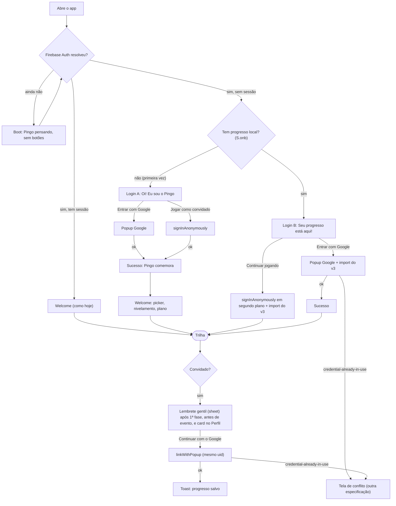

# Tela de login: especificação de UX/UI

Para o `dev-fullstack` implementar. Dois caminhos: **Entrar com Google** e **Jogar como convidado** (anônimo). Sem e-mail e senha. Decisões de auth e dados estão em `docs/backend.md` (seções 5 e 6); aqui só a camada de interface.

## 1. Direção visual

A tela de login é o Pingo acordando. Fundo roxo profundo com brilho radial atrás do robô (o único glow da tela), o Pingo grande flutuando, "dados" coloridos (pixels) à deriva e um anel de sonar ciano saindo da antena, como se ele estivesse dando um ping para você. O texto vem na voz dele, em primeira pessoa, curto. Os botões são os `.btn` degrau do jogo (amarelo e ghost ciano); o botão do Google é a única peça branca, por exigência da marca. Zero cara de SaaS: não há card de formulário, o mascote é o conteúdo.

## 2. Decisão: Login substitui ou conversa com o `Welcome.tsx`?

**Conversa, sem substituir.** `Welcome.tsx` continua sendo onboarding (escolha de curso, nivelamento, plano) e a saudação de quem volta. O Login é uma porta nova **antes** dele, só quando não há sessão Firebase.

| Situação | Tela de login | Depois |
|---|---|---|
| Primeira vez (sem `pingoquest-v3`) | Variante A | `Welcome` (picker, nivelamento, plano) |
| Já jogava neste aparelho, sem conta (`S.onb` verdadeiro) | Variante B | Trilha direto (a variante B já fez a saudação; `welcome=false`) |
| Já logado (Google ou convidado) | Pula | `Welcome` "Que bom te ver de novo" como hoje |

Por quê: o `Welcome` já cumpre bem o onboarding e não tem nada de auth; misturar os dois faria o fluxo de quem volta passar por duas saudações seguidas.

## 3. Fluxo

Regras de fluxo:
- O Login só aparece com `status === 'out'`. Enquanto `booting`, mostrar o Boot (sem botões) para quem já tem sessão nunca ver um flash de login.
- Boot demorando mais de 4 s: aparece a linha "Está demorando mais que o normal..."; se houver progresso local, aparece o botão "Jogar sem conexão por enquanto" (entra na trilha em modo local e o sign-in anônimo tenta de novo em segundo plano). Sem progresso local, só a mensagem.
- Na variante B, "Continuar jogando" **não bloqueia em rede**: entra na trilha e o `signInAnonymously` + import rodam em segundo plano com retry. Quem já jogava não pode ser barrado por falta de internet. (A confirmar com `backend.md` seção 5: import só acontece quando o servidor confirmar.)
- Convite de amigo por hash (`inviteFromHash`) e duelo pendente (`pendingDuel`): fora do escopo, ver seção 9.

## 4. Layout e microcopy

Container: `<main id="login">`, tela cheia, **sempre tema escuro roxo**, independente do tema salvo (a marca é roxo profundo; o tema claro continua valendo dentro do app). Coluna central `max-width: 400px`, padding lateral 20px, `padding-bottom: calc(20px + env(safe-area-inset-bottom))`.

### Hierarquia (o que o olho vê, em ordem)

1. **Pingo** (176px, com glow roxo atrás e sonar na antena)
2. **Título** (h1, 28px, 900, branco)
3. **Botão principal** (Google branco na variante A; amarelo "Continuar jogando" na B)
4. **Botão secundário** (ghost ciano na A; Google branco na B)
5. Texto de apoio e letras miúdas (muted)

Estrutura vertical em 375x667: bloco do Pingo e título centralizados na metade de cima (`flex:1`); botões ancorados embaixo, na zona do polegar. Em altura baixa (`max-height:560px` em paisagem): Pingo reduz para 96px e vira duas colunas (Pingo e título à esquerda, botões à direita).

### Variante A: primeira vez

| Elemento | Texto exato |
|---|---|
| Wordmark (acima do Pingo, `
`, lilás, 13px, 800, caixa alta, tracking 0.12em) | `PINGO QUEST` |
| h1 | `Oi! Eu sou o Pingo.` |
| Subtítulo | `Vou te ensinar Redes e Linux, um passo de cada vez.` |
| Botão 1 (Google, branco) | `Entrar com Google` |
| Botão 2 (`.btn.ghost`) | `Jogar como convidado` |
| Apoio sob os botões (muted, 14px, centralizado) | `Com Google, seu progresso fica guardado e você libera amigos e presentes. Como convidado, você joga já e salva depois.` |
| Letra miúda (13px) | `Ao continuar, você aceita os Termos e a Política de Privacidade.` (links `<a>`, páginas pendentes, ver `backend.md` seção 6, passo 3) |

Por que o Google em cima: é o caminho que retém (progresso salvo, social) e, por ser branco sobre roxo profundo, já é naturalmente o elemento de maior contraste. O convidado fica a um toque, sem esconder. A frase de apoio vende o Google como ganho, não o convidado como falta.

### Variante B: já tem progresso neste aparelho

O Pingo usa o **avatar equipado** do jogador (o componente já faz isso via `avCfg(S)`), mood `happy`: é o robô dele quem aparece.

| Elemento | Texto exato |
|---|---|
| h1 | `Seu progresso está aqui!` |
| Subtítulo | `Nada foi perdido. Tudo continua guardado neste aparelho.` |
| Faixa de números (reusa `.mini`) | `{n}/{total}` fases, `{dias}` dias de brilho (omitir se 0), `{chips}` chips |
| Botão 1 (`.btn` amarelo) | `Continuar jogando` |
| Divisor (muted) | `ou` |
| Botão 2 (Google) | `Entrar com Google` |
| Apoio | `Entrando com Google, seu progresso vai junto e fica salvo na nuvem.` |

Por que amarelo aqui: quem já joga quer continuar, essa é a ação principal; o Google é um upgrade opcional.

### Pingo e sons

| Momento | Pingo (mood do `Pingo.tsx`) | Movimento | Som (`sfx`, sempre opcional) |
|---|---|---|---|
| Ocioso | `happy` | flutua (`wbob`), pisca (já embutido), sonar ciano a cada 3,2 s, dados à deriva | nenhum (áudio só destrava após o primeiro toque) |
| Toque no Pingo | igual | pulo e frase, já tratado pelo `PingoPoke` (nada a fazer) | `boop` (já existe) |
| Carregando (popup aberto ou criando convidado) | `think` | sonar passa a 1,2 s, sem flutuar | `ping` ao abrir o popup; `start` ao tocar em convidado |
| Erro | `sad` por 2,4 s, depois volta a `happy` (a mensagem fica) | um balanço curto, sem tremor | `bad` |
| Cancelou o popup | `happy` | nenhuma | nenhum |
| Sucesso | `cheer` | pulo, `confetti()` | `win` |

Os mesmos sons respeitam `setSound`/`soundOn` de `app/src/lib/sound.ts`. Nenhum som toca sozinho.

## 5. Estados

Regra geral: erro aparece **inline**, acima dos botões, num bloco `role="alert"` (não toast, para não sumir antes de ser lido). Cores: `--bad-bg` de fundo, `--bad-ink` de texto, borda `--bad`, raio 14px, ícone de aviso à esquerda (não depender só da cor). Os botões voltam ao normal para permitir nova tentativa.

### Carregando

| Estado | O que muda na tela |
|---|---|
| **Boot** (Firebase iniciando) | Fundo e Pingo `think` no lugar; no lugar dos botões, duas barras skeleton do tamanho dos botões (52px) com shimmer suave; `role="status"` `aria-label="Abrindo o Pingo Quest"`. Sem spinner. Após 4 s: `Está demorando mais que o normal...` |
| **Popup Google aberto** | Botão Google: texto vira `Abrindo o Google...`, mantém logo e fundo branco, `aria-busy="true"`, sem opacidade reduzida. Botão convidado: `aria-disabled="true"`, opacidade .5. Linha de apoio troca para `Termine o login na janelinha do Google.` Pingo `think` |
| **Criando convidado** | Botão convidado: `Preparando seu robô...`, `aria-busy`. Botão Google: `aria-disabled`. Pingo `think` |

Usar `aria-disabled` e não `disabled`, para o foco não ser perdido durante o carregamento. Ignorar cliques enquanto estiver ocupado.

### Erro (por tipo)

| Causa (código Firebase) | Mensagem exata | Ação |
|---|---|---|
| Fechou o popup (`auth/popup-closed-by-user`, `auth/cancelled-popup-request`) | Não é erro. Sem bloco vermelho. Texto de apoio vira `Tudo bem, sem pressa.` por 3 s | Botões normais |
| Popup bloqueado (`auth/popup-blocked`) | `O navegador bloqueou a janelinha do Google. Libere pop-ups para este site e tente de novo.` | Botão Google vira `Tentar de novo` (continua com o logo) |
| Sem internet (`auth/network-request-failed`) | `Sem internet por aqui. Confira a conexão e tente de novo.` | Mesmo botão tentar de novo. Na variante B, "Continuar jogando" segue funcionando |
| Navegador embutido (Instagram, WhatsApp etc.; `auth/operation-not-supported-in-this-environment`, `disallowed_useragent`) | `O Google não abre dentro deste navegador. Abra o Pingo Quest no Chrome ou no Safari.` | Convidado continua disponível |
| Conta bloqueada (`auth/user-disabled`) | `Essa conta Google não pode entrar. Tente outra ou jogue como convidado.` | |
| Muitas tentativas (`auth/too-many-requests`) | `Muitas tentativas seguidas. Espere um minutinho e tente de novo.` | |
| Conta Google já ligada a outro progresso (`auth/credential-already-in-use`) | Sem mensagem aqui: o Login **navega para a tela de conflito** ("Neste aparelho" x "Na sua conta Google"), especificada à parte (`backend.md`, seção "Conflito") | Só apontar |
| Qualquer outro | `Algo deu errado do nosso lado. Tente de novo em instantes.` e, em letra miúda, o código (`auth/xyz`) para suporte | Tentar de novo |
| Convidado falhou (rede) na variante A | `Não consegui preparar seu robô sem internet. Conecte-se e tente de novo.` | Botão volta a `Jogar como convidado` |

Todo erro vai para o log com contexto (código e etapa), nunca engolido em silêncio (regra global de error handling).

### Sucesso

1. Pingo `cheer`, `confetti()`, `sfx('win')`.
2. h1 troca para `Conectado! Bora jogar.` (Google) ou `Tudo pronto! Bora jogar.` (convidado) e some a área de botões (cai com fade de 150 ms). Região `role="status"` anuncia a mesma frase.
3. Após 900 ms (500 ms com `prefers-reduced-motion`), transição para o destino (seção 2) com `Overlay`/`enter` de `Fx.tsx`. O toque em qualquer lugar pula a espera.
4. Variante B: a frase é `Seu progresso está salvo. Bora jogar!`.

## 6. Salvar progresso com Google (convidado)

Nunca bloqueia e nunca repete sem parar. Três pontos de entrada, do mais calmo ao mais contextual.

| Onde | Quando | Aparência | Texto |
|---|---|---|---|
| **Card no Perfil** (`Profile.tsx`, logo abaixo do `.ph`, acima de Cursos) | Sempre que `isAnonymous` | `.card` (borda superior amarela), Pingo `love` pequeno à esquerda, botão do Google | Título: `Salvar progresso com Google`. Corpo: `Hoje seu progresso só existe neste aparelho. Salvando, você não perde nada, joga em outro aparelho e libera amigos e presentes.` |
| **Lembrete (sheet)** | Uma vez após a 1ª fase concluída; antes do 1º evento; no máximo 1 vez a cada 7 dias; depois de 3 "Agora não", só o card do Perfil | `#modal .sheet` existente, com `popIn`. Pingo `love`. Fecha com Esc e "Agora não" | Título: `Salvar seu progresso?`. Corpo: `Você já avançou bastante. Com Google, nada se perde se o celular trocar ou o navegador limpar.` Botões: Google e `Agora não` (ghost) |
| **Ponto no Perfil** (aba da barra) | Convidado após a 1ª fase, até abrir o Perfil uma vez | `.dot` rosa existente (`dots.profile`), valor `1` | rótulo do leitor de tela: `Perfil, 1 novidade` |

Rotas sociais (Amigos, presentes, duelo): convidado vê o conteúdo **bloqueado em vez de escondido** (padrão de estado bloqueado do design system: dessaturado, cadeado), com Pingo `wink` e: `Amigos e presentes moram na conta Google.` / `Salve seu progresso e eles aparecem aqui.` + botão Google. Sem a palavra "erro", sem tom de proibição. Não mostrar `account_required` ao usuário.

Estados do botão e erros: **idênticos** aos da seção 5 (mesmo componente). Sucesso (mesmo uid, via `linkWithPopup`): `confetti(18)` pequeno, `sfx('win')`, toast `Progresso salvo na sua conta Google!`, o card do Perfil vira uma linha `Conta Google conectada` com check verde (sem mostrar e-mail). Conflito: tela de conflito, a mesma.

## 7. Botão do Google (marca)

Seguir as diretrizes de marca do Google. O **logo "G" oficial** vem do kit oficial (developers.google.com/identity/branding-guidelines), em SVG inline, sem recolorir nem distorcer.

| Item | Valor |
|---|---|
| Fundo | `#FFFFFF` (tema claro do kit), borda 1px `#747775` |
| Texto | `#1F1F1F`, Roboto 500 (carregar via `@fontsource/roboto/500.css`, latin) |
| Texto do rótulo | `Entrar com Google`. Em contextos de ligar conta (Perfil, sheet): `Continuar com o Google` (rótulo permitido pela marca; "Salvar com Google" **não** é permitido como rótulo, por isso o "Salvar progresso com Google" vira título do card, não texto do botão) |
| Altura | 52px (acima do mínimo de 44px), largura total, raio 16px (igual ao `.btn`) |
| Logo | 20px, 12px de respiro à esquerda do texto; conteúdo centralizado |
| Degrau | `box-shadow: 0 4px 0 #B8AEDB`; `:active` desce 4px (igual ao `.btn`) |
| Foco | `outline: 3px solid var(--cyan); outline-offset: 3px` |

É a **única exceção** à regra "botão principal amarelo": a marca do Google manda, o resto da tela segue o design system.

## 8. Tokens, classes e componentes

### Reaproveitar

| O quê | Onde |
|---|---|
| Paleta (`--roxo`, `--roxo-fundo`, `--lilas`, `--ciano-neon`, `--rosa`, `--amarelo`) e tokens de tema escuro (`--bg`, `--surface`, `--ink`, `--muted`, `--line`, `--bad*`, `--cyan`) | `app/src/legacy/jogo.css` (`:root` e `:root[data-theme="dark"]`) |
| `.btn` (amarelo, degrau), `.btn.ghost`, `.note` | `app/src/legacy/jogo.css` |
| `.mini` (faixa de números), `.card`, `.dot`, `#modal .sheet`, `.sect` | `app/src/legacy/jogo.css`, usados em `app/src/Profile.tsx` |
| `@keyframes wbob` (flutuar) e o fundo `body` escuro `#1b0944 -> #12053a` | `app/src/legacy/jogo.css` |
| Componente `Pingo` (com `mood` e avatar equipado) | `app/src/Pingo.tsx`, `app/src/lib/pingo.ts` (moods: `happy`, `cheer`, `sad`, `think`, `sleep`, `love`, `wink`) |
| Reação ao toque no Pingo (pulo, sonar, frases) | `app/src/PingoPoke.tsx` (funciona sozinho em qualquer `svg[aria-label^="Pingo"]`; o `z-index` do Login deve ficar abaixo de 120) |
| `confetti`, `enter`, `popIn`, `Overlay`, `stagger`, `MotionConfig` | `app/src/Fx.tsx` |
| `sfx`, `buzz`, `reducedMotion`, `soundOn` | `app/src/lib/sound.ts` |
| `done`, `totalFases`, `streakNow`, `S.gems` para a faixa da variante B | `app/src/lib/cursos.ts`, `app/src/lib/progress.ts` |

### Novo

| Item | Arquivo | Nota |
|---|---|---|
| `Login` (variantes A e B, Boot, estados) | `app/src/Login.tsx` | Props: dados do save (`S`), `onDone(dest)` |
| `GoogleButton` (logo, rótulo, `loading`, `error`) | `app/src/GoogleButton.tsx` | Usado no Login, no card do Perfil e no sheet |
| `SaveProgressCard` e `SaveProgressSheet` | `app/src/SaveProgress.tsx` | Card no Perfil e lembrete com a regra de frequência (`pingoquest-save-nudge` em localStorage: última vez e nº de dispensas) |
| Estilos `#login`, `.lg-*` | `app/src/app.css` | Ver abaixo |
| `Sonar` (anel ciano que se expande, hoje inline no `PingoPoke`) | `app/src/Fx.tsx` | Extrair o `motion.i` do `PingoPoke` e reusar nos dois |
| Toast | `app/src/Fx.tsx` | Só se não existir toast no app (não achei um); simples, `role="status"`, 3 s |
| Gate no `App.tsx` | `app/src/App.tsx` | `booting` -> Boot; `out` -> Login; senão fluxo atual. Manter `FxLayer` e `PingoPoke` montados também no gate |

CSS novo (essencial):
- `:root[data-theme="dark"], #login { ...tokens escuros... }`: acrescentar `#login` ao seletor que já define o tema escuro, para a tela ser sempre roxa sem duplicar variáveis.
- `#login`: `position:fixed; inset:0; z-index:80` (acima do `#welcome` 70, abaixo do `PingoPoke` 120), fundo `radial-gradient(60% 40% at 50% 28%, color-mix(in srgb, var(--roxo) 55%, transparent), transparent 70%), linear-gradient(180deg,#1b0944,#12053a)`.
- `.lg-pingo`: 176px (200px a partir de `md`), `animation: wbob 3.2s ease-in-out infinite`.
- `.lg-bits`: 6 `<i>` de 6 a 10px nas cores da paleta, `aria-hidden`, deriva de 7 a 11 s, opacidade .7.
- `.lg-gbtn`: botão do Google (seção 7).
- `.lg-err`: bloco de erro.
- `.lg-skel`: skeleton de botão (52px, `--surface`, shimmer 1.4 s).
- Alvos: `min-height:44px` em tudo que é interativo, inclusive links do rodapé (`padding-block:10px`).
- Nada de `transition: all`; usar `transform`, `opacity`, `box-shadow`.
- Enter do conteúdo: `opacity + translateY(12px)` em 280 ms, escalonado com `stagger`.

### Responsivo

| Largura | Comportamento |
|---|---|
| 375 | Coluna única, Pingo 176px, botões ancorados embaixo, padding 20px |
| 768 | Mesma coluna (400px) centralizada na vertical e na horizontal, Pingo 200px, botões deixam de ficar ancorados e sobem para logo abaixo do texto |
| 1440 | Idêntico ao 768; o fundo roxo preenche e os dados flutuam por toda a área. Não esticar botões |
| Paisagem baixa (< 560px de altura) | Duas colunas, Pingo 96px |

## 9. Acessibilidade (WCAG 2.2 AA)

- [ ] `<main>` único; h1 é o título (`Oi! Eu sou o Pingo.`); o wordmark é `
`, não heading
- [ ] Todos os botões são `<button type="button">`; links dos termos são `<a>` reais
- [ ] Alvos >= 44px (botões 52px, links 44px com `padding`); espaçamento >= 8px entre alvos
- [ ] Foco visível (outline ciano 3px com offset) em todos os interativos; ordem do Tab: Google, convidado (ou Continuar, Google na B), Termos, Privacidade
- [ ] Ao montar, o foco vai para o h1 (`tabIndex={-1}`); depois de um erro, o foco **permanece** no botão que disparou
- [ ] Carregando usa `aria-busy` + `aria-disabled` (não `disabled`); estado anunciado em região `role="status"` (`aria-live="polite"`)
- [ ] Erros em `role="alert"` com ícone e texto (nunca só cor); sem `aria-describedby` necessário, o bloco antecede os botões
- [ ] Contraste: branco sobre `#150638` ~16:1; `--muted` `#b9a9e4` sobre o fundo ~8:1; texto escuro sobre amarelo ok; `--bad-ink` sobre `--bad-bg` ~8:1; ciano `#18ddfb` do ghost sobre `--surface` ~9:1. Conferir com ferramenta antes do merge, principalmente o muted sobre o brilho radial
- [ ] `prefers-reduced-motion`: sem flutuar, sem sonar, sem dados à deriva (ficam parados, ou ocultos), sem confete (o `confetti()` já retorna cedo), espera de sucesso 500 ms; troca de mood continua (não é movimento)
- [ ] Pingo (SVG) mantém `role="img"` e `aria-label`; os dados flutuantes e o brilho são `aria-hidden`; o sentido de cada estado vai no texto, não no mood
- [ ] Texto >= 16px no corpo (apoio 14px e letra miúda 13px são secundários; manter o contraste acima); `text-wrap: balance` nos títulos, `pretty` no apoio
- [ ] Reflow: sem rolagem horizontal em 320px; zoom 200% mantém os botões visíveis (a tela pode rolar na vertical)
- [ ] Não é `role="dialog"` (é uma tela inteira); o `Welcome` seguinte já é diálogo e mantém `autoFocus`
- [ ] Sem cronômetro obrigatório: a espera de sucesso pode ser pulada com toque ou Enter
- [ ] Idioma da página `pt-BR`; sons nunca automáticos

## 10. Fora do escopo

- Tela de conflito (conta Google já ligada a outro progresso): só o gancho de navegação aqui
- Lógica de auth, `bootstrap`, `import`, `merge-intent`, `adopt`, regras e rotas (`docs/backend.md`)
- Sair da conta, trocar de conta, excluir conta e dados (LGPD)
- Código de recuperação para convidados (decisão pendente R9)
- Convite de amigo por link e duelo pendente chegando para convidado ou deslogado (precisa de decisão: provavelmente Google obrigatório com texto próprio)
- Páginas de Termos e Política de Privacidade (os links existem; o conteúdo, não)
- Login por e-mail, senha, telefone, Apple ou outros provedores
- Tema claro da tela de login, internacionalização além do pt-BR
- Ilustração nova do Pingo ou novos moods (usar os existentes)
- Telas de verificação de idade e consentimento de menores
- Testes automatizados (ficam com o `qa-engineer`; esta spec define o comportamento)
